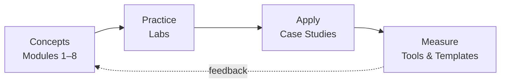

# Welcome to EMAN EWAIS Labs

This knowledge base connects three disciplines that are usually taught separately: **identity security**, **cybersecurity and IT governance**, and **AI risk**. Each module pairs concise explanations with hands-on labs, simulated case studies and browser-based tools.

## How the platform is organised

## Content status

Every lab, project and case study carries one of four labels so readers always know what they are looking at:

| Label | Meaning |
|---|---|
| **Planned** | Scope agreed; content not yet written. |
| **Draft** | Written and reviewed; not yet executed end-to-end. |
| **Simulated** | Uses fictional organisations and data; no real tenant involved. |
| **Validated** | Executed in an isolated lab tenant, with execution evidence retained. |

:::warning[Authorised environments only]
Perform every exercise only in a test tenant or lab you own or are explicitly authorised to use. Never apply lab configurations to a production environment without your organisation's change-management approval.
:::

## References policy

Technical content cites official sources — Microsoft Learn, NIST, ISACA, ISO, OWASP, CISA and the Qatar National Cyber Security Agency — with versions or publication dates where available. ISO standards are summarised, never reproduced.
