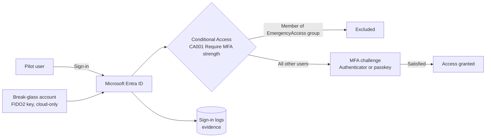

import useBaseUrl from '@docusaurus/useBaseUrl';

# LAB-001 — Configure MFA in Microsoft Entra ID

<LabMeta
  id="LAB-001"
  difficulty="Beginner"
  duration="45–60 minutes"
  status="validated"
  licences={[
    'Path A — Microsoft Entra ID Free (security defaults)',
    'Path B — Microsoft Entra ID P1 or higher (Conditional Access)',
  ]}
  prerequisites={[
    'A test tenant you own — never production',
    'Global Administrator in that tenant (to set up)',
    'A phone with Microsoft Authenticator, or a FIDO2 security key',
  ]}
  tools={['Microsoft Entra admin center', 'Microsoft Graph PowerShell (optional)', 'A private browser window']}
  reviewed="2026-11-10"
/>

## 1. Learning objectives

By the end of this lab you will be able to:

1. Explain the difference between **security defaults** and **Conditional Access**, and when each is appropriate.
2. Create and protect an **emergency access (break-glass) account** before enforcing any sign-in control.
3. Enable authentication methods for a pilot group using the **authentication methods policy**.
4. Build a Conditional Access policy that requires the **multifactor authentication strength**, test it in **report-only** mode, then enforce it.
5. Prove the control works using sign-in logs — the evidence an auditor would ask for.

## 2. Difficulty and duration

**Beginner.** Path A takes about 20 minutes; Path B about 45–60 minutes including validation.

## 3. Prerequisites

- A **dedicated test tenant**. Entra ID P1 is needed only for Path B; check **Billing → Licenses → All products** in your test tenant for trial options available to you.
- Basic familiarity with the Microsoft Entra admin center ([entra.microsoft.com](https://entra.microsoft.com)).
- Module 1 concepts: authentication factors and the difference between authentication and authorization.

## 4. Required tools and licences

| Capability used in this lab | Free (security defaults) | P1 | Notes |
|---|---|---|---|
| MFA for all users | ✓ (Authenticator app only) | ✓ | Security defaults cannot be customised — on or off |
| Choose which methods are allowed | — | ✓ | Authentication methods policy |
| Conditional Access | — | ✓ | Security defaults must be **disabled** before Conditional Access is used |
| Sign-in logs through Microsoft Graph API | — | ✓ | Portal sign-in logs are available on all tiers |
| Risk-based Conditional Access | — | — | Requires P2 — out of scope here |

Source: Microsoft Learn, *Features and licenses for Microsoft Entra multifactor authentication* and *Security defaults in Microsoft Entra ID* (see references).

## 5. Lab architecture



**Fictional organisation:** *Al Waha Trading (simulated)* — 3 test users, 1 pilot group, 2 emergency access accounts.

## 6. Security and safety considerations

:::danger[Lock-out risk]
A Conditional Access policy targeting **All users** can lock every administrator out of the tenant. Always create and test emergency access accounts **first**, exclude them from blocking policies, and use **report-only** mode before switching a policy on.
:::

- Use **only test identities** with fictional names. Never use real employee data.
- Emergency access accounts must be **cloud-only** (`*.onmicrosoft.com`), use a **phishing-resistant method** (passkey/FIDO2 recommended) different from your normal admin method, and be monitored with an alert on every sign-in.
- Do not paste tenant IDs, user object IDs or screenshots containing them into public posts.
- **2026 change to plan for:** Microsoft announced that from **1 September 2026** passkeys become the default authentication experience in Entra ID (public cloud), and that native SMS/voice delivery is retired on **1 February 2027**. Design this lab around Authenticator and passkeys, not SMS.

## 7. Step-by-step instructions

<LabProgress
  labId="LAB-001"
  steps={[
    'Create test users and a pilot group',
    'Create two emergency access accounts and the EmergencyAccess group',
    'Choose Path A (Free) or Path B (P1)',
    'Path B: enable methods in the authentication methods policy',
    'Path B: create CA001 in report-only mode',
    'Register MFA as the pilot user',
    'Review report-only results, then switch CA001 to On',
    'Collect validation evidence',
  ]}
/>

### Step 1 — Create test users and a pilot group

1. Sign in to the Microsoft Entra admin center as a Global Administrator **of the test tenant**.
2. Go to **Entra ID → Users → All users → New user → Create new user**. Create:
   - `lab.user1@<tenant>.onmicrosoft.com` — *Lab User One*
   - `lab.user2@<tenant>.onmicrosoft.com` — *Lab User Two*
3. Go to **Entra ID → Groups → All groups → New group**. Create a **Security** group named `GRP-MFA-Pilot` and add `lab.user1`.

### Step 2 — Create emergency access accounts

1. Create two cloud-only users, for example `bg-admin-01@<tenant>.onmicrosoft.com` and `bg-admin-02@<tenant>.onmicrosoft.com`, with long random passwords stored offline.
2. Assign each the **Global Administrator** role (permanent active, not eligible).
3. Register a **FIDO2 security key / passkey** on each account.
4. Create a security group `EmergencyAccess` and add both accounts. You will exclude this group from enforced policies.

:::tip[Governance note]
Record the break-glass accounts in your privileged account register with an owner, storage location of credentials and a **quarterly** sign-in test date. Microsoft recommends validating them at least every 90 days.
:::

### Step 3 — Choose your path

| | Path A — Security defaults | Path B — Conditional Access |
|---|---|---|
| Licence | Free | P1 |
| Scope control | Whole tenant | Users, groups, apps, conditions |
| Exclusions | Not possible | Yes (break-glass, sync accounts) |
| Best for | Small tenants with no P1 | Organisations with P1 and audit requirements |

**Path A — security defaults (Free):**

1. Go to **Entra ID → Overview → Properties → Manage security defaults**.
2. Set **Security defaults** to **Enabled** and select **Save**.
3. Skip to Step 6. (Steps 4, 5 and 7 apply to Path B only.)

**Path B — Conditional Access (P1):** if security defaults are on, disable them first (same menu, set to **Disabled**). Continue with Step 4 immediately so the tenant is not left without MFA.

### Step 4 — Enable authentication methods for the pilot group (Path B)

1. Go to **Entra ID → Authentication methods → Policies**.
2. Open **Microsoft Authenticator** → **Enable** → target **Select groups** → `GRP-MFA-Pilot` → **Save**.
3. Open **Passkey (FIDO2)** → **Enable** → target `GRP-MFA-Pilot` (and `EmergencyAccess`) → **Save**.
4. Leave SMS and voice **disabled** for the pilot.

### Step 5 — Create Conditional Access policy `CA001` in report-only (Path B)

1. Go to **Entra ID → Conditional Access → Policies → New policy**.
2. **Name:** `CA001 - All users - All resources - Require MFA strength`
3. **Assignments → Users:** Include **All users**. Exclude **Users and groups → `EmergencyAccess`**. If you use Entra Connect, also exclude **Directory roles → Directory Synchronization Accounts**.
4. **Target resources → Resources:** Include **All resources**.
5. **Access controls → Grant:** **Grant access** → **Require authentication strength** → **Multifactor authentication strength** → **Select**.
6. **Enable policy:** **Report-only** → **Create**.

:::note
Microsoft's guidance: external authentication methods are currently incompatible with authentication strength. If you use one, choose the **Require multifactor authentication** grant control instead.
:::

### Step 6 — Register MFA as the pilot user

1. Open a **private browser window** and sign in to `https://myaccount.microsoft.com` as `lab.user1`.
2. Follow the prompts to register **Microsoft Authenticator** (or a passkey). Complete the test notification.
3. Sign out and sign in again to [myapps.microsoft.com](https://myapps.microsoft.com).

### Step 7 — Review report-only results, then enforce (Path B)

1. Go to **Entra ID → Monitoring & health → Sign-in logs**. Open the sign-in for `lab.user1` → **Report-only** tab. `CA001` should show **Report-only: Success** or **Report-only: Interrupted** (would have required MFA).
2. Open a sign-in for a break-glass account — `CA001` should show **Not applied** (excluded).
3. When results match expectations, open `CA001` → set **Enable policy** to **On** → **Save**.

### Step 8 — Collect validation evidence

See section 10. Save the evidence (with tenant identifiers redacted) in your lab evidence folder.

## 8. Expected results

| Test | Expected outcome |
|---|---|
| **Path A** — `lab.user1` first sign-in | Sign-in **interrupted**: the user must register an MFA method (no 14-day grace period since July 2024) |
| **Path A** — later sign-ins by `lab.user1` | MFA **only when Microsoft judges it necessary** (location, device, role, task). A repeat sign-in from the same device can be single-factor — this is documented behaviour, not a failure |
| **Path A** — administrators | MFA on **every** sign-in |
| **Path B** — `lab.user1` signs in after enforcement | Prompted for MFA on every sign-in that `CA001` covers |
| `lab.user2` (no method registered) signs in | Required to register a method before access |
| Break-glass account signs in | `CA001` **Not applied**; passkey satisfies mandatory MFA |
| Sign-in log for `lab.user1` (Path B) | Authentication requirement: *Multifactor authentication*; `CA001` **Success** |

:::info[Finding from validation]
The first version of this guide expected `lab.user1` to be prompted for MFA on every sign-in under security defaults. Executing the lab showed — and Microsoft's documentation confirms — that security defaults prompt regular users **only when necessary**. If your requirement is *MFA on every sign-in for every user*, you need Conditional Access (Path B / LAB-002).
:::

## 9. Validation procedures

**Portal evidence**

- **Sign-in logs** → filter by user → *Authentication Details* tab shows the method used and *Conditional Access* tab shows `CA001` result.
- **Conditional Access → What If**: user `lab.user2`, any cloud app → `CA001` listed under *Policies that will apply*; `bg-admin-01` → listed under *Policies that will not apply*.

**PowerShell evidence (read-only)** — run from a workstation, sign in with an admin account of the test tenant:

```powershell
# Install once (current user scope, no admin rights needed)
Install-Module Microsoft.Graph -Scope CurrentUser

# Read-only scopes only
Connect-MgGraph -Scopes "Policy.Read.All","AuditLog.Read.All","Directory.Read.All"

# Path A: is security defaults enabled?
Get-MgPolicyIdentitySecurityDefaultEnforcementPolicy | Select-Object DisplayName, IsEnabled

# Path B: list Conditional Access policies and their state
Get-MgIdentityConditionalAccessPolicy |
  Select-Object DisplayName, State |
  Sort-Object DisplayName

# Path B (P1 needed for sign-in logs via Graph): last 5 sign-ins for the pilot user
Get-MgAuditLogSignIn -Filter "userPrincipalName eq 'lab.user1@<tenant>.onmicrosoft.com'" -Top 5 |
  Select-Object CreatedDateTime, AppDisplayName, ConditionalAccessStatus

Disconnect-MgGraph
```

Expected: `IsEnabled : True` (Path A) **or** `CA001 … State : enabled` and `ConditionalAccessStatus : success` (Path B).

## 10. Evidence checklist for auditors

| Evidence | Supports |
|---|---|
| Screenshot / export of `CA001` configuration | Control design |
| Sign-in log entries showing MFA satisfied | Control operating effectiveness |
| What If results for included and excluded users | Scope and exclusions are intentional |
| Break-glass register + last test date | Compensating control for exclusion |

These map to ISO/IEC 27001:2022 Annex A controls **5.17 Authentication information** and **8.5 Secure authentication**, and to NIST CSF 2.0 **PR.AA** (Identity Management, Authentication, and Access Control).

## 11. Troubleshooting

| Symptom | Likely cause | Fix |
|---|---|---|
| *"Security defaults must be disabled to enable Conditional Access policy"* | Security defaults still on | Disable security defaults, then immediately create `CA001` |
| User never prompted for MFA | Policy in report-only, or user excluded | Check **Enable policy** and the user's group membership; use **What If** |
| Everyone prompted except you expected | Exclusion targets the wrong group | Exclude the `EmergencyAccess` **group**, not individual users |
| Pilot user can't register Authenticator | Method not enabled for their group | Authentication methods → Microsoft Authenticator → check target group |
| `Get-MgAuditLogSignIn` returns *403 / license* error | Graph sign-in logs need P1 | Use the portal sign-in logs, or add a P1 trial |
| Admin locked out | No working break-glass account | Sign in with `bg-admin-01` using the FIDO2 key; set `CA001` to Report-only |

## 12. Cleanup and rollback

1. Set `CA001` to **Off**, then delete it if not reused in LAB-002.
2. Path A: leave security defaults **enabled** unless you are moving to Conditional Access — a tenant should not be left with neither.
3. Delete `lab.user1`, `lab.user2` and `GRP-MFA-Pilot`.
4. Keep the emergency access accounts if the tenant will be used for later labs; otherwise remove their role assignments and delete them.

## 13. Knowledge check

<KnowledgeCheck
  questions={[
    {
      q: 'Your tenant has Entra ID P1 and you want to create a Conditional Access policy. Security defaults are enabled. What must happen first?',
      options: [
        'Nothing — they work together',
        'Security defaults must be disabled',
        'Upgrade to P2',
        'Enable per-user MFA for all users',
      ],
      answer: 1,
      explanation:
        'Microsoft Learn states organisations implementing Conditional Access to replace security defaults must disable security defaults first. Do it immediately before creating the replacement policy.',
    },
    {
      q: 'Which authentication method does Microsoft recommend for emergency access accounts?',
      options: [
        'SMS one-time code',
        'Voice call to the IT manager',
        'Passkey (FIDO2) or certificate-based authentication',
        'No MFA so they always work',
      ],
      answer: 2,
      explanation:
        'Microsoft recommends phishing-resistant methods that satisfy mandatory MFA — passkey (FIDO2), or certificate-based authentication if you already run a PKI — and a method different from normal admin accounts.',
    },
    {
      q: 'Why create CA001 in report-only mode first?',
      options: [
        'Report-only is cheaper to license',
        'To evaluate the impact in sign-in logs without blocking anyone',
        'Report-only policies enforce MFA only for admins',
        'It is required before deleting a policy',
      ],
      answer: 1,
      explanation:
        'Report-only mode evaluates the policy and records the outcome in sign-in logs without enforcing it, so you can confirm scope and exclusions before switching it on.',
    },
    {
      q: 'Which artefact best demonstrates that the MFA control is OPERATING effectively, not just designed?',
      options: [
        'The policy configuration screenshot',
        'The MFA policy document',
        'Sign-in log entries showing MFA satisfied for in-scope users over a period',
        'The licence invoice',
      ],
      answer: 2,
      explanation:
        'Configuration shows design. Sign-in logs over a sample period show the control actually operated — the distinction auditors draw between design and operating effectiveness.',
    },
  ]}
/>

## 14. Official references

- Microsoft Learn — [Security defaults in Microsoft Entra ID](https://learn.microsoft.com/entra/fundamentals/security-defaults) (reviewed 2026-11-07)
- Microsoft Learn — [Features and licenses for Microsoft Entra multifactor authentication](https://learn.microsoft.com/entra/identity/authentication/concept-mfa-licensing)
- Microsoft Learn — [Require multifactor authentication strength for all users](https://learn.microsoft.com/entra/identity/conditional-access/policy-all-users-mfa-strength) (last updated 2026-03-24)
- Microsoft Learn — [Manage emergency access admin accounts](https://learn.microsoft.com/entra/identity/role-based-access-control/security-emergency-access) (last updated 2026-06-05)
- Microsoft Security Blog — [Passkeys are the default authentication method in Entra ID](https://www.microsoft.com/en-us/security/blog/2026/07/13/microsoft-entra-id-security-updates-passkeys-are-the-default-authentication-method-in-entra-id/) (13 July 2026)
- NIST — [Cybersecurity Framework 2.0](https://www.nist.gov/cyberframework) (February 2024)

## 15. Validation record

| Field | Value |
|---|---|
| Content status | **Validated** — Path A (Microsoft Entra ID Free, security defaults) |
| Executed | 10 November 2026, by Eman Ewais |
| Environment | Personal test tenant (Entra ID Free), created for these labs; no production or employer data |
| Path B (Conditional Access) | Not executed in this run — requires Entra ID P1; covered by LAB-002 |
| Deviations from the guide | Emergency access accounts not created (Path A run; requires a FIDO2 key). The Path A expected results were corrected after execution (see the finding in section 8) |
| Next review | By 2027-02-01 (Microsoft SMS/voice delivery change) |

### Results

| Check | Result |
|---|---|
| Security defaults enabled | ✅ "Your organization is protected by security defaults" |
| Test users and pilot group created | ✅ `Lab User One`, `Lab User Two`, `GRP-MFA-Pilot` |
| MFA registration enforced on first sign-in | ✅ First `lab.user1` sign-in **Interrupted** with authentication requirement *Multifactor authentication*; Microsoft Authenticator registered |
| Registered method | ✅ Microsoft Authenticator (iPhone), default sign-in method *Microsoft Authenticator notification* |
| Sign-in logs record each attempt | ✅ Interrupted → Success sequences recorded for `lab.user1` |

### Evidence (redacted)

Tenant name and IDs, domains, request IDs, IP addresses and the administrator's email are redacted.

<details>
<summary>1 · Security defaults enabled</summary>

</details>

<details>
<summary>2 · Test users created</summary>

</details>

<details>
<summary>3 · Pilot group created</summary>

</details>

<details>
<summary>4 · Microsoft Authenticator registered for Lab User One</summary>

</details>

<details>
<summary>5 · Sign-in logs</summary>

</details>
