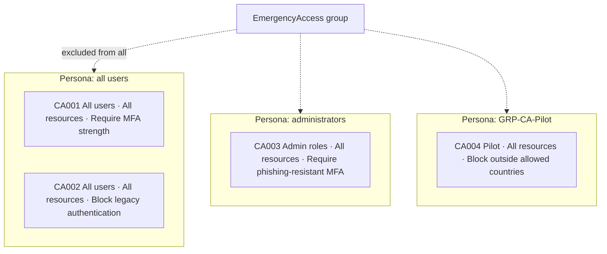

# LAB-002 — Create and Validate Conditional Access Policies

<LabMeta
  id="LAB-002"
  difficulty="Intermediate"
  duration="75–90 minutes"
  status="draft"
  licences={['Microsoft Entra ID P1 or higher (Conditional Access)']}
  prerequisites={[
    'LAB-001 completed (break-glass accounts, EmergencyAccess group, CA001)',
    'LAB-003 objects available (helpdesk.doha with AU-scoped role) — for the coverage-gap exercise',
    'Conditional Access Administrator in the test tenant',
  ]}
  tools={['Microsoft Entra admin center', 'What If tool', 'Microsoft Graph PowerShell (read-only export)']}
  reviewed="2026-11-07"
/>

## 1. Learning objectives

1. Design Conditional Access as a **policy set** organised by persona, with a naming standard.
2. Build three common baseline policies following Microsoft's templates.
3. Use **report-only** mode and the **What If** tool to predict outcomes before enforcement.
4. Explain and demonstrate a **policy conflict** (Block wins) and a **coverage gap** (AU-scoped roles).
5. Export the configuration as change-management and audit evidence.

## 2. Difficulty and duration

**Intermediate**, 75–90 minutes.

## 3. Prerequisites

- **LAB-001** — break-glass accounts, the `EmergencyAccess` group and policy `CA001` exist.
- **LAB-003** — the user `helpdesk.doha` holds Helpdesk Administrator **scoped to an administrative unit**. (If you skipped LAB-003, you can still complete everything except Step 6.)
- Phishing-resistant method (passkey / FIDO2) registered for at least one test admin **before** Step 4.

## 4. Required tools and licences

| Item | Requirement |
|---|---|
| Conditional Access, named locations, What If | Entra ID **P1** |
| Authentication strengths | Included with Conditional Access |
| Risk conditions (sign-in / user risk) | P2 — **not used** in this lab |

## 5. Lab architecture — the policy set



**Naming standard:** `CA### - Persona - Target resources - Control`. Numbered, sortable, and readable in sign-in logs.

## 6. Security and safety considerations

:::danger[Lock-out risk]
`CA002`, `CA003` and `CA004` can block administrators. Exclude `EmergencyAccess` from **every** policy, create everything in **Report-only**, and verify you can sign in with a break-glass account before switching anything **On**.
:::

- Test tenant and fictional users only.
- Do not apply country blocks to administrators until you have a tested travel and emergency procedure.
- Policy exports contain object IDs — redact before sharing outside your team.

## 7. Step-by-step instructions

<LabProgress
  labId="LAB-002"
  steps={[
    'Create the GRP-CA-Pilot group and the Allowed countries named location',
    'Create CA002 Block legacy authentication (report-only)',
    'Register phishing-resistant methods for admins',
    'Create CA003 Phishing-resistant MFA for admin roles (report-only)',
    'Create CA004 Block outside allowed countries for the pilot (report-only)',
    'Run What If: find the coverage gap for helpdesk.doha',
    'Run What If: reproduce the conflict for a travelling pilot user',
    'Review report-only sign-in results and enforce',
    'Export the policy set as evidence',
  ]}
/>

### Step 1 — Group and named location

1. **Entra ID → Groups → New group** → Security group `GRP-CA-Pilot`; add `lab.user1`.
2. **Entra ID → Conditional Access → Named locations → Countries location**.
   - Name: `NL-Allowed-Countries`
   - Select **Qatar** (add any other countries your test scenario needs) → **Create**.

### Step 2 — CA002 Block legacy authentication

Following Microsoft's template:

1. **Entra ID → Conditional Access → Policies → New policy**.
2. Name: `CA002 - All users - All resources - Block legacy authentication`
3. **Users:** Include **All users** · Exclude **`EmergencyAccess`**.
4. **Target resources:** Include **All resources**.
5. **Conditions → Client apps:** Configure **Yes** → select only **Exchange ActiveSync clients** and **Other clients** → **Done**.
6. **Grant:** **Block access**.
7. **Enable policy:** **Report-only** → **Create**.

:::tip[Why it matters]
Legacy protocols (POP, IMAP, SMTP AUTH, older Office clients) cannot perform MFA. If they are allowed, an attacker with a password simply bypasses CA001 by choosing an old protocol.
:::

### Step 3 — Register phishing-resistant methods for admins

Before requiring it, make sure admins **have** it: register a passkey (FIDO2) for each test admin, or issue a **Temporary Access Pass** so they can bootstrap one.

### Step 4 — CA003 Phishing-resistant MFA for administrators

1. Name: `CA003 - Admin roles - All resources - Require phishing-resistant MFA`
2. **Users → Include → Select users and groups → Directory roles.** Select at least: Global Administrator, Privileged Role Administrator, Privileged Authentication Administrator, Security Administrator, Conditional Access Administrator, Authentication Administrator, User Administrator, **Helpdesk Administrator**, Password Administrator, Application Administrator, Cloud Application Administrator, Exchange Administrator, SharePoint Administrator, Billing Administrator.
3. **Exclude:** `EmergencyAccess`.
4. **Target resources:** **All resources**.
5. **Grant:** **Require authentication strength → Phishing-resistant MFA**.
6. **Report-only** → **Create**.

### Step 5 — CA004 Block outside allowed countries (pilot)

1. Name: `CA004 - GRP-CA-Pilot - All resources - Block outside allowed countries`
2. **Users:** Include `GRP-CA-Pilot` · Exclude `EmergencyAccess`.
3. **Target resources:** **All resources**.
4. **Conditions → Locations:** Configure **Yes** → Include **Any location** → Exclude **Selected locations → `NL-Allowed-Countries`**.
5. **Grant:** **Block access**.
6. **Report-only** → **Create**.

### Step 6 — What If: find the coverage gap

1. **Entra ID → Conditional Access → Policies → What If**.
2. Identity: **`helpdesk.doha`** (Helpdesk Administrator scoped to `AU-Doha` from LAB-003). Target resource: any cloud app. Provide device platform and client app.
3. Run the evaluation and look for `CA003`.

**Expected:** `CA003` is under **policies that don't apply**. Microsoft documents that directory-role targeting in Conditional Access applies to **built-in roles at tenant scope** — it is **not enforced for administrative-unit-scoped or custom roles**. Your delegated helpdesk analyst is an administrator who is *not* covered by the admin policy.

**Fix:** create a role-assignable or security group such as `GRP-Delegated-Admins`, add AU-scoped administrators to it, and add that group to `CA003`'s **Include** list. Re-run What If — `CA003` should now apply.

:::info[What this teaches]
"We require phishing-resistant MFA for all administrators" can be a false statement even when the policy exists. A coverage test with What If turns a policy claim into evidence.
:::

### Step 7 — What If: reproduce the conflict

1. Run What If for `lab.user1` (member of `GRP-CA-Pilot`) with a **location outside Qatar** (enter a country or an IP address from another country, if the tool offers it).
2. **Expected:** both `CA001` (require MFA) and `CA004` (block) apply. **The result is Block** — all applicable policies must be satisfied, and Block cannot be satisfied.
3. Re-run with the location set to Qatar — only `CA001` (and `CA002` if the client app is legacy) applies.

Write down the business decision this raises: how does a pilot user travelling for work get access? (Typical answers: a time-bound travel exception group excluded from `CA004`, approved through a ticket.)

### Step 8 — Review report-only results and enforce

1. **Monitoring & health → Sign-in logs** → open recent sign-ins → **Report-only** tab. Look for *Report-only: Failure* (would have blocked) and confirm each is expected.
2. Optional: **Conditional Access → Insights and reporting** shows the aggregate impact of report-only policies (requires a Log Analytics workspace).
3. Confirm a break-glass account can still sign in.
4. Switch `CA002`, then `CA003`, then `CA004` to **On** — one at a time, verifying sign-ins after each.

### Step 9 — Export the policy set as evidence

```powershell
Connect-MgGraph -Scopes "Policy.Read.All"

# Human-readable summary
Get-MgIdentityConditionalAccessPolicy |
  Sort-Object DisplayName |
  Select-Object DisplayName, State, CreatedDateTime, ModifiedDateTime |
  Format-Table -AutoSize

# Full JSON export for change records (contains object IDs - store securely)
$stamp = Get-Date -Format "yyyyMMdd-HHmm"
Get-MgIdentityConditionalAccessPolicy |
  ConvertTo-Json -Depth 10 |
  Out-File ".\CA-policies-$stamp.json" -Encoding utf8

Disconnect-MgGraph
```

## 8. Expected results

| What If / sign-in | Policies applied | Outcome |
|---|---|---|
| `lab.user1`, Qatar, modern client | CA001 | MFA required → access |
| `lab.user1`, outside Qatar | CA001 + CA004 | **Blocked** |
| Any user, IMAP / POP client | CA002 (+ CA001) | **Blocked** |
| Global Administrator test account | CA001 + CA003 | Phishing-resistant MFA required |
| `helpdesk.doha` **before** fix | CA001 only | Gap — admin not covered by CA003 |
| `helpdesk.doha` **after** fix | CA001 + CA003 | Phishing-resistant MFA required |
| `bg-admin-01` | None (excluded) | Access with passkey |

## 9. Validation procedures

1. **Design review** — every policy follows the naming standard and excludes `EmergencyAccess`.
2. **Predictive test** — What If results match section 8 for each persona.
3. **Observed test** — sign-in logs show the expected policy results after enforcement.
4. **Coverage test** — every account holding any administrative role (tenant or AU scope) is covered by CA003.
5. **Evidence** — JSON export stored with the change ticket.

## 10. Troubleshooting

| Symptom | Likely cause | Fix |
|---|---|---|
| Admin blocked after enabling CA003 | No phishing-resistant method registered | Use break-glass, set CA003 to report-only, issue a Temporary Access Pass, register a passkey |
| What If shows *does not apply* unexpectedly | Missing input (app, location, client app) | The What If evaluation needs all relevant sign-in details to evaluate conditions |
| What If with "Office 365" app group doesn't match | App groups aren't matched by the What If API | Select a specific app |
| Users on Outlook mobile blocked by CA002 | Device uses Exchange ActiveSync basic auth | Move users to a modern-auth client; legacy auth cannot do MFA |
| Policy set to On but no effect | User excluded via nested group, or policy targets wrong role | Check exclusions and run What If for that user |

## 11. Cleanup and rollback

- Set `CA004` to **Off** (country blocks are unsuitable for a shared test tenant).
- Keep `CA001`–`CA003` if the tenant is used for further labs; otherwise set to Off and delete.
- Delete `GRP-CA-Pilot` and `NL-Allowed-Countries` if no longer needed.
- Rollback for any policy: set **Enable policy** to **Report-only** — the change is immediate for new sign-ins.

## 12. Governance implications

- Conditional Access policies are **security configuration items**: changes need a change ticket, peer review and a before/after export.
- Every exclusion is a **risk acceptance**: document owner, reason and review date.
- Maps to ISO/IEC 27001:2022 Annex A **8.5 Secure authentication**, **5.15 Access control**, **8.2 Privileged access rights**, **8.32 Change management**; NIST CSF 2.0 **PR.AA** and **PR.PS**.

## 13. Knowledge check

<KnowledgeCheck
  questions={[
    {
      q: 'A user matches a policy that requires MFA and another that blocks access. What is the outcome?',
      options: ['MFA, then access', 'Blocked', 'Whichever policy is newer', 'Random'],
      answer: 1,
      explanation: 'All applicable policies must be satisfied; a Block control cannot be satisfied, so access is blocked.',
    },
    {
      q: 'CA003 targets the Helpdesk Administrator directory role. Why did it not apply to helpdesk.doha?',
      options: [
        'The user has no licence',
        'Directory-role targeting is not enforced for administrative-unit-scoped (or custom) role assignments',
        'What If is broken',
        'Helpdesk Administrator is not a real role',
      ],
      answer: 1,
      explanation: 'Microsoft documents that role-based targeting applies to built-in roles and is not enforced for AU-scoped or custom roles. Target a group instead.',
    },
    {
      q: 'Why block legacy authentication even when an MFA policy exists?',
      options: [
        'Legacy clients are slow',
        'Legacy protocols cannot perform MFA, so they bypass MFA policies',
        'It saves licences',
        'It is required for What If',
      ],
      answer: 1,
      explanation: 'Basic-auth protocols only send a password; an attacker can use them to avoid the MFA requirement entirely.',
    },
    {
      q: 'Which evidence best supports a claim that "all admins require phishing-resistant MFA"?',
      options: [
        'The policy name',
        'A screenshot of CA003',
        'What If results and sign-in logs for every admin persona, including delegated AU-scoped admins',
        'The licence invoice',
      ],
      answer: 2,
      explanation: 'Coverage must be demonstrated per persona; a policy can exist and still miss a population.',
    },
  ]}
/>

## 14. Official references

- Microsoft Learn — [Block legacy authentication with Conditional Access](https://learn.microsoft.com/entra/identity/conditional-access/policy-block-legacy-authentication) (last updated 2026-03-24)
- Microsoft Learn — [Require phishing-resistant MFA for administrators](https://learn.microsoft.com/entra/identity/conditional-access/policy-admin-phish-resistant-mfa) (last updated 2026-03-24 — includes the AU-scoped/custom role limitation)
- Microsoft Learn — [Use the What If tool](https://learn.microsoft.com/entra/identity/conditional-access/what-if-tool) (last updated 2026-08-27)
- Microsoft Learn — [Report-only mode](https://learn.microsoft.com/entra/identity/conditional-access/concept-conditional-access-report-only)
- Microsoft Learn — [Location condition in Conditional Access](https://learn.microsoft.com/entra/identity/conditional-access/concept-assignment-network)

## 15. Lab record

| Field | Value |
|---|---|
| Content status | Draft — not yet executed end-to-end |
| Execution evidence | None published |
| Next review | Before marking *Validated* |
