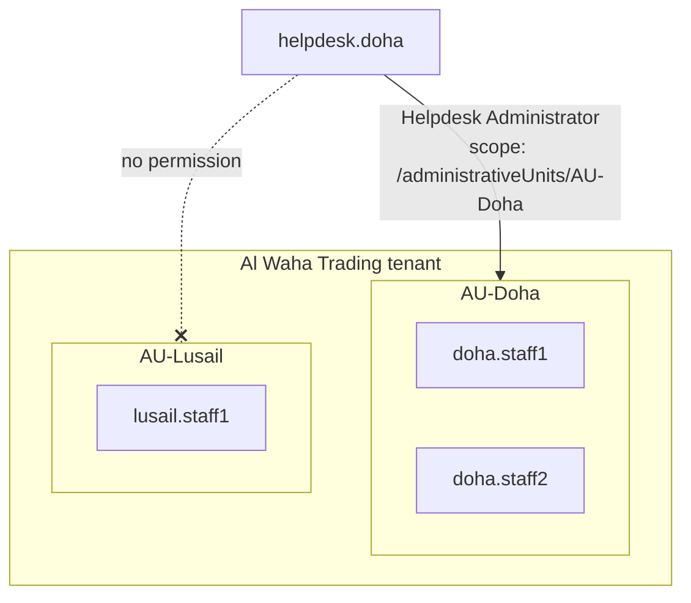

# LAB-003 — Implement RBAC with Administrative Units

<LabMeta
  id="LAB-003"
  difficulty="Intermediate"
  duration="60–75 minutes"
  status="draft"
  licences={[
    'Creating administrative units — Entra ID Free',
    'Each administrator assigned a role scoped to an AU — Entra ID P1',
  ]}
  prerequisites={[
    'A test tenant you own — never production',
    'Privileged Role Administrator (or Global Administrator) in the test tenant',
    'LAB-001 completed, so admin accounts use MFA',
  ]}
  tools={['Microsoft Entra admin center', 'Microsoft Graph PowerShell', 'A private browser window']}
  reviewed="2026-11-07"
/>

## 1. Learning objectives

1. Translate job tasks into a **least-privilege role matrix** (persona → task → role → scope).
2. Explain why a **tenant-wide** role assignment is over-privileged for a regional helpdesk.
3. Create **administrative units (AUs)** and delegate the **Helpdesk Administrator** role to one AU.
4. Prove the boundary with a **positive test** (allowed action succeeds) and a **negative test** (out-of-scope action is denied).
5. Reproduce the configuration with **Microsoft Graph PowerShell** so it is repeatable and reviewable.

## 2. Difficulty and duration

**Intermediate**, about 60–75 minutes.

## 3. Business scenario

*Al Waha Trading (simulated)* has two offices: **Doha** and **Lusail**. Each office has a local IT support analyst who resets passwords for staff in **their own office only**. Today both analysts hold **Helpdesk Administrator at tenant scope**, so either can reset any non-admin user's password across the company — an internal audit finding against the least-privilege principle.

**Goal:** restrict each analyst to their own office without slowing down support.

## 4. Required tools and licences

| Item | Licence |
|---|---|
| Create AUs and add members | Entra ID Free |
| Assign a role **scoped to an AU** | Entra ID **P1** for each administrator receiving the scoped role |
| Dynamic AU membership rules | P1 for each AU member (not used in this lab) |
| Privileged Identity Management (just-in-time activation) | P2 / ID Governance — see Module 4 (not used here) |

Without P1 you can still complete Steps 1–3 and the role-matrix design, and observe the over-privileged tenant-wide assignment.

## 5. Lab architecture



## 6. Security and safety considerations

- Work **only** in a test tenant with fictional users.
- Role assignments are **privileged changes**. In a real organisation they go through change management, with a ticket reference recorded in the assignment justification.
- Use a **private browser window** for the helpdesk test account so you don't mix sessions with your admin account.
- The PowerShell in this lab writes to the directory. Read each block before running it.

## 7. Step-by-step instructions

<LabProgress
  labId="LAB-003"
  steps={[
    'Design the role matrix',
    'Create test users',
    'Create AU-Doha and AU-Lusail and add members',
    'Assign Helpdesk Administrator scoped to AU-Doha',
    'Positive test: reset a Doha user password',
    'Negative test: attempt a Lusail user password reset',
    'Reproduce with Microsoft Graph PowerShell',
    'Record evidence',
  ]}
/>

### Step 1 — Design the role matrix

Least privilege starts on paper, not in the portal.

| Persona | Task | Least-privileged built-in role | Scope | Why not a broader role? |
|---|---|---|---|---|
| Doha IT analyst | Reset passwords for Doha staff | Helpdesk Administrator | AU-Doha | User Administrator can also create and delete users — not needed |
| Lusail IT analyst | Reset passwords for Lusail staff | Helpdesk Administrator | AU-Lusail | Same |
| IAM engineer | Manage role assignments | Privileged Role Administrator | Tenant | Must not also be a helpdesk analyst (separation of duties) |
| Break-glass | Emergency recovery only | Global Administrator | Tenant | Monitored; see LAB-001 |

:::tip[Separation of duties]
The person who **assigns** roles (Privileged Role Administrator) should not be the person who **uses** helpdesk roles. Record this rule in your SoD matrix.
:::

### Step 2 — Create test users

In **Entra ID → Users → All users → New user → Create new user**, create:

| User | Office (Usage location / Office field) |
|---|---|
| `doha.staff1@<tenant>.onmicrosoft.com` | Doha |
| `doha.staff2@<tenant>.onmicrosoft.com` | Doha |
| `lusail.staff1@<tenant>.onmicrosoft.com` | Lusail |
| `helpdesk.doha@<tenant>.onmicrosoft.com` | Doha (the analyst) |

### Step 3 — Create administrative units

1. Go to **Entra ID → Roles & admins → Admin units → Add**.
2. Name `AU-Doha`, description *Doha office users (lab)* → **Create**.
3. Repeat for `AU-Lusail`.
4. Open `AU-Doha` → **Users → Add member** → add `doha.staff1` and `doha.staff2`.
5. Open `AU-Lusail` → add `lusail.staff1`.

### Step 4 — Assign the role scoped to AU-Doha (P1)

1. Open `AU-Doha` → **Roles and administrators** → **Helpdesk Administrator**.
2. **Add assignments** → select `helpdesk.doha` → **Add**.
3. Go to **Entra ID → Roles & admins → Roles & admins → Helpdesk Administrator → Assignments**. Confirm the **Scope** column shows `AU-Doha`, **not** *Directory*.

### Step 5 — Positive test

1. In a private window, sign in to the Entra admin center as `helpdesk.doha` (register MFA if prompted).
2. Go to **Entra ID → Roles & admins → Admin units → AU-Doha → Users → doha.staff1 → Reset password**.
3. **Expected:** a temporary password is generated.

### Step 6 — Negative test

1. Still as `helpdesk.doha`, browse to **Users → All users → lusail.staff1**.
2. Attempt **Reset password**.
3. **Expected:** the action is unavailable or fails with an insufficient-privileges message.

:::info[Why negative tests matter]
A control that only has positive tests proves the analyst **can** work. Only the negative test proves the boundary — which is what the audit finding was about.
:::

### Step 7 — Reproduce with Microsoft Graph PowerShell

Run as an administrator of the **test** tenant. This creates objects; review before running.

```powershell
Connect-MgGraph -Scopes "AdministrativeUnit.ReadWrite.All","RoleManagement.ReadWrite.Directory","User.Read.All"

$tenantDomain = "<tenant>.onmicrosoft.com"   # replace with your TEST tenant domain

# 1. Create the administrative unit
$au = New-MgDirectoryAdministrativeUnit -DisplayName "AU-Doha-PS" `
        -Description "Doha office users (lab, created by PowerShell)"

# 2. Add Doha users as members
foreach ($upn in @("doha.staff1@$tenantDomain", "doha.staff2@$tenantDomain")) {
    $user = Get-MgUser -UserId $upn
    New-MgDirectoryAdministrativeUnitMemberByRef -AdministrativeUnitId $au.Id `
        -OdataId "https://graph.microsoft.com/v1.0/users/$($user.Id)"
}

# 3. Assign Helpdesk Administrator scoped to the AU
$role    = Get-MgRoleManagementDirectoryRoleDefinition -Filter "displayName eq 'Helpdesk Administrator'"
$analyst = Get-MgUser -UserId "helpdesk.doha@$tenantDomain"

New-MgRoleManagementDirectoryRoleAssignment `
    -RoleDefinitionId $role.Id `
    -PrincipalId      $analyst.Id `
    -DirectoryScopeId "/administrativeUnits/$($au.Id)"

# 4. Verify: list assignments for the analyst and their scopes
Get-MgRoleManagementDirectoryRoleAssignment -Filter "principalId eq '$($analyst.Id)'" |
    Select-Object RoleDefinitionId, DirectoryScopeId
```

**Expected output of step 4:** one assignment whose `DirectoryScopeId` begins with `/administrativeUnits/`. A value of `/` means **tenant-wide** — that is the over-privileged state you are removing.

### Step 8 — Record evidence

Capture (with tenant identifiers redacted):

- The role matrix from Step 1.
- The **Assignments** view showing scope `AU-Doha`.
- Audit log entries: **Entra ID → Monitoring & health → Audit logs**, filter *Category: RoleManagement* and *Activity: Reset password* for the positive test.
- A screenshot or note of the denied action in the negative test.

## 8. Expected results

| Test | Expected |
|---|---|
| `helpdesk.doha` resets `doha.staff1` password | ✅ Succeeds |
| `helpdesk.doha` resets `lusail.staff1` password | ❌ Denied |
| `Get-MgRoleManagementDirectoryRoleAssignment` scope | `/administrativeUnits/<id>` |
| Audit log | Role assignment and password reset events recorded with actor and target |

## 9. Validation procedures

1. **Configuration check** — no Helpdesk Administrator assignment at scope `/` remains for regional analysts.
2. **Behavioural check** — positive and negative tests both behave as expected.
3. **Log check** — the audit log shows who reset which password and when.
4. **Review check** — the role matrix is approved by the IAM owner and dated.

## 10. Troubleshooting

| Symptom | Likely cause | Fix |
|---|---|---|
| **Roles and administrators** missing inside the AU | Signed in without Privileged Role Administrator | Use an account with Privileged Role Administrator |
| Analyst can still reset Lusail users | An old tenant-wide assignment still exists | Remove the assignment with scope *Directory* |
| Analyst cannot reset a Doha user | User is not a member of `AU-Doha`, or the target user holds an admin role | Check AU membership; helpdesk roles cannot reset passwords of higher-privileged admins |
| `New-MgRoleManagementDirectoryRoleAssignment` returns *Authorization_RequestDenied* | Missing consent for `RoleManagement.ReadWrite.Directory` | Reconnect with the scopes listed and accept consent as an admin |
| Scoped assignment blocked with a licence message | AU-scoped administrators require P1 | Assign a P1 (trial) licence to the analyst |

## 11. Cleanup and rollback

```powershell
# Remove the scoped assignment and the PowerShell-created AU (test tenant only)
$assignment = Get-MgRoleManagementDirectoryRoleAssignment -Filter "principalId eq '$($analyst.Id)'"
Remove-MgRoleManagementDirectoryRoleAssignment -UnifiedRoleAssignmentId $assignment.Id
Remove-MgDirectoryAdministrativeUnit -AdministrativeUnitId $au.Id
Disconnect-MgGraph
```

Then in the portal: delete `AU-Doha`, `AU-Lusail` and the four test users.

## 12. Governance implications

- Scoped delegation reduces the **blast radius** if an analyst account is compromised.
- Role assignments should be reviewed periodically through **access reviews** — see LAB-005.
- Maps to ISO/IEC 27001:2022 Annex A **5.15 Access control**, **5.18 Access rights**, **8.2 Privileged access rights**, and **5.3 Segregation of duties**; and to NIST CSF 2.0 **PR.AA**.

## 13. Knowledge check

<KnowledgeCheck
  questions={[
    {
      q: 'A role assignment shows DirectoryScopeId "/". What does this mean?',
      options: [
        'The assignment is disabled',
        'The role applies tenant-wide',
        'The role applies to the root administrative unit only',
        'The assignment is eligible, not active',
      ],
      answer: 1,
      explanation: '"/" is the tenant-wide (directory) scope. An AU-scoped assignment uses "/administrativeUnits/<id>".',
    },
    {
      q: 'Which licence does an administrator need to receive a role scoped to an administrative unit?',
      options: ['None — it is free', 'Entra ID P1', 'Entra ID P2 only', 'Microsoft 365 E5 only'],
      answer: 1,
      explanation:
        'Microsoft Learn: creating AUs and adding members is Free, but each administrator assigned a role over an AU scope requires Entra ID P1.',
    },
    {
      q: 'Why is the negative test (attempting a Lusail reset) essential?',
      options: [
        'It is required by Microsoft licensing',
        'It proves the scope boundary actually restricts access',
        'It resets the audit log',
        'It activates the role',
      ],
      answer: 1,
      explanation: 'Positive tests prove capability. Only a negative test proves the restriction the control is meant to enforce.',
    },
    {
      q: 'A helpdesk analyst also needs to create new user accounts. What is the best least-privilege response?',
      options: [
        'Make them Global Administrator',
        'Assign User Administrator tenant-wide',
        'Confirm the business need, then assign the narrowest role and scope that covers it, and document it',
        'Share an admin account',
      ],
      answer: 2,
      explanation:
        'Least privilege means validating the need first, then granting the narrowest role at the narrowest scope, with a documented justification and review.',
    },
  ]}
/>

## 14. Official references

- Microsoft Learn — [Administrative units in Microsoft Entra ID](https://learn.microsoft.com/entra/identity/role-based-access-control/administrative-units) (licence requirements)
- Microsoft Learn — [Assign Microsoft Entra roles with administrative unit scope](https://learn.microsoft.com/entra/identity/role-based-access-control/admin-units-assign-roles) (roles that support AU scope)
- Microsoft Learn — [Best practices for Microsoft Entra roles](https://learn.microsoft.com/entra/identity/role-based-access-control/best-practices) (last updated 2026-06-01)
- Microsoft Learn — [Microsoft Entra built-in roles](https://learn.microsoft.com/entra/identity/role-based-access-control/permissions-reference)
- Microsoft Learn — [New-MgRoleManagementDirectoryRoleAssignment](https://learn.microsoft.com/powershell/module/microsoft.graph.identity.governance/new-mgrolemanagementdirectoryroleassignment)

## 15. Lab record

| Field | Value |
|---|---|
| Content status | Lab guide — not yet executed end-to-end |
| Execution evidence | None published |
| Next review | Before marking *Validated* |
