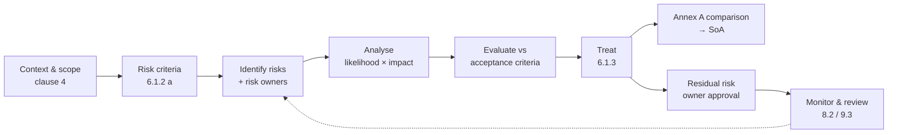

import useBaseUrl from '@docusaurus/useBaseUrl';

# LAB-007 — Build an ISO/IEC 27001 Risk Register

<LabMeta
  id="LAB-007"
  difficulty="Intermediate"
  duration="90 minutes"
  status="simulated"
  licences={['None — spreadsheet only']}
  prerequisites={[
    'Basic understanding of confidentiality, integrity and availability',
    'Access to ISO/IEC 27001:2022 (purchased copy) is helpful but not required',
  ]}
  tools={['Excel, Google Sheets or LibreOffice Calc', 'The CSV template provided below']}
  reviewed="2026-11-07"
/>

## 1. Learning objectives

1. Define **risk criteria** — including **risk acceptance criteria** — before assessing anything.
2. Identify risks to **confidentiality, integrity and availability** within a defined scope and assign a **risk owner** to each.
3. Analyse and evaluate risks with a transparent **likelihood × impact** method.
4. Select a **treatment option** and map treatments to **ISO/IEC 27001:2022 Annex A** controls.
5. Record **residual risk** and the risk owner's approval — the link to the Statement of Applicability (SoA).

## 2. Difficulty and duration

**Intermediate**, about 90 minutes.

## 3. What ISO/IEC 27001 actually requires (summary, not the text)

| Clause | Requirement in brief | Where it appears in this lab |
|---|---|---|
| 6.1.2 | Define and apply a risk assessment process: establish criteria (incl. acceptance criteria), produce consistent, valid and comparable results, identify risks and risk owners, analyse and evaluate | Steps 1–5 |
| 6.1.3 | Define and apply a risk treatment process: choose options, determine controls, compare with Annex A, produce the SoA, formulate a treatment plan, obtain risk owners' approval of the plan and acceptance of residual risk | Steps 6–8 |
| 8.2 | Perform risk assessments at planned intervals or when significant changes occur, and retain documented results | Step 9 |
| 8.3 | Implement the risk treatment plan and retain documented results | Step 9 |

:::note[Mandatory vs recommended]
The **process** and its **documented information** are mandatory. A 5 × 5 matrix, the column layout and the scoring bands below are **not** mandated by the standard — they are one common, auditable way to meet the requirement. ISO/IEC 27005:2022 gives guidance; it is not certifiable.
:::

## 4. Required tools and licences

No licences. Download the template and open it in any spreadsheet tool:

<div className="margin-bottom--md">
  <a className="button button--primary" href={useBaseUrl('/templates/iso27001-risk-register-template.csv')} download="iso27001-risk-register-template.csv">Download risk register template (CSV)</a>
</div>

The template contains **five simulated example risks** for *Al Waha Trading* so you can see a completed row before writing your own.

## 5. Lab architecture — the risk process



## 6. Safety and confidentiality considerations

- Use the **fictional** organisation provided. Do not put real company assets, vulnerabilities or supplier names into a public portfolio.
- A real risk register is **confidential** — it is effectively a map of your weaknesses. Classify and restrict it accordingly.

## 7. Step-by-step instructions

<LabProgress
  labId="LAB-007"
  steps={[
    'Define scope',
    'Define risk criteria and acceptance criteria',
    'Build an asset / process inventory',
    'Identify risks and risk owners',
    'Analyse each risk (likelihood × impact)',
    'Evaluate and select treatment options',
    'Map treatments to Annex A controls',
    'Record residual risk and owner approval',
    'Set the review cycle',
  ]}
/>

### Step 1 — Define scope

**Simulated scope statement:** *"The ISMS covers the customer sales, finance and HR processes of Al Waha Trading at its Doha head office, including supporting cloud services."*

Write one sentence of scope before identifying any risk — risks outside scope are not assessed in this register.

### Step 2 — Define risk criteria

Use this exercise to see how likelihood and impact combine. Change the values and watch the cell move in the matrix.

<RiskScorer />

Record your criteria in a separate **"Criteria"** sheet:

| Likelihood | Meaning (example) | Impact | Meaning (example) |
|---|---|---|---|
| 1 Rare | Not expected in 5 years | 1 Negligible | No customer or financial effect |
| 2 Unlikely | Once in 2–5 years | 2 Minor | Internal disruption < 4 hours |
| 3 Possible | Once in 1–2 years | 3 Moderate | Limited customer impact, < QAR 100k |
| 4 Likely | Several times a year | 4 Major | Regulatory notification, significant loss |
| 5 Almost certain | Monthly or more | 5 Severe | Prolonged outage, major regulatory or reputational damage |

**Risk acceptance criteria (example):** Low — accept; Medium — accept with risk owner sign-off; High — treat within 90 days; Critical — treat immediately and escalate to management.

:::tip
Clause 6.1.2 b requires that repeated assessments produce **consistent, valid and comparable results**. Written definitions like the table above are how you achieve that — two assessors should score the same scenario the same way.
:::

### Step 3 — Build an asset / process inventory

List what you are protecting. For the simulation: *CRM customer database, finance file share, payroll outsourcing provider, staff email, public website.*

### Step 4 — Identify risks and risk owners

For each asset write **threat + vulnerability → consequence to C, I or A**. Example:

> *Credential stuffing* (threat) exploits *no MFA on CRM* (vulnerability) → *disclosure of customer data* (confidentiality).

Assign a **risk owner** — the person with the accountability and authority to manage the risk (usually a business owner, **not** IT by default).

### Step 5 — Analyse each risk

Score likelihood and impact considering **existing controls**. In the spreadsheet add:

```text
Inherent score  (J2):  =H2*I2
Inherent level  (K2):  =IF(J2>=20,"Critical",IF(J2>=10,"High",IF(J2>=5,"Medium","Low")))
```

### Step 6 — Evaluate and choose a treatment option

Compare each level against your acceptance criteria and choose an option (terminology from ISO/IEC 27005:2022):

| Option | Meaning | Simulated example |
|---|---|---|
| **Modify** | Add or change controls to reduce risk | R-001: enforce MFA on CRM |
| **Retain** | Accept the risk as is, by informed decision | R-005: low-impact website risk |
| **Avoid** | Stop the activity causing the risk | Decommission an unused system |
| **Share** | Transfer part of the risk (contract, insurance) | R-003: security clauses with payroll provider |

### Step 7 — Map treatments to Annex A controls

ISO/IEC 27001:2022 Annex A lists **93 controls** in **four themes**: Organizational (5.x), People (6.x), Physical (7.x) and Technological (8.x). Clause 6.1.3 c requires you to **compare** the controls you selected with Annex A to make sure nothing necessary was omitted.

| Risk | Treatment | Annex A controls |
|---|---|---|
| R-001 CRM credential stuffing | Enforce MFA | 5.17 Authentication information · 8.5 Secure authentication |
| R-002 Ransomware | Offline, tested backups; anti-malware | 8.13 Information backup · 8.7 Protection against malware |
| R-003 Supplier breach | Contract clauses, supplier assessment | 5.19 · 5.20 Supplier relationships and agreements |
| R-004 Phishing | Awareness training, MFA | 6.3 Awareness, education and training · 8.5 |
| R-005 Website defacement | Patch regularly | 8.8 Management of technical vulnerabilities |

Every control selected here must appear in the **Statement of Applicability** with its justification and implementation status.

### Step 8 — Record residual risk and owner approval

Re-score likelihood and impact **assuming the planned controls are implemented**:

```text
Residual score (R2):  =P2*Q2
Residual level (S2):  =IF(R2>=20,"Critical",IF(R2>=10,"High",IF(R2>=5,"Medium","Low")))
```

The risk owner then **approves the treatment plan and accepts the residual risk** (clause 6.1.3 f). In the template these are marked *Pending* because the organisation is fictional — in a real ISMS this signature is audit evidence.

### Step 9 — Set the review cycle

Set **Next review** for every risk and define triggers for an unscheduled reassessment: new system, major change, incident, new regulation (for example, obligations under Qatar's Personal Data Privacy Protection Law), or a significant supplier change.

## 8. Expected results

A register in which every row has: scope-relevant asset, threat, vulnerability, CIA consequence, named risk owner, inherent score and level, treatment option, Annex A mapping, residual score and level, approval status and next review date.

| Simulated risk | Inherent | Residual |
|---|---|---|
| R-001 CRM credential stuffing | 16 High | 8 Medium |
| R-002 Ransomware on finance share | 15 High | 6 Medium |
| R-003 Payroll supplier breach | 12 High | 8 Medium |
| R-004 Phishing | 12 High | 6 Medium |
| R-005 Website defacement | 4 Low | 4 Low (retained) |

## 9. Validation procedures — self-audit checklist

| Check | Pass condition |
|---|---|
| Criteria defined before assessment | Criteria sheet exists and is dated earlier than the register |
| Every risk has an owner | No blank *Risk owner* cells |
| Arithmetic is correct | Score = likelihood × impact on every row |
| Levels match criteria | Level formula uses the documented bands |
| Treatment consistent with criteria | No High/Critical risk is *Retain* without management justification |
| Annex A mapping present | Every *Modify* row lists at least one control |
| Residual risk approved | Approval name and date recorded (pending in this simulation) |
| SoA consistency | Every control in the register appears in the SoA |

## 10. Troubleshooting

| Problem | Cause | Fix |
|---|---|---|
| Two assessors score the same risk differently | Criteria too vague | Add measurable examples to each level |
| Register has 300 rows and nobody reads it | Risks recorded per technical finding | Group at scenario level; keep vulnerabilities in the vulnerability register |
| IT is the owner of every risk | Ownership confused with implementation | The risk owner is accountable; IT can be the *treatment* owner |
| Residual risk equals inherent risk | Planned controls don't affect likelihood or impact | Re-check the treatment, or choose a different option |
| CSV opens with garbled characters in Excel | Encoding | Use **Data → From Text/CSV** and choose **UTF-8** |

## 11. Cleanup

Nothing to clean up. Keep your completed register as a portfolio artefact **only** with fictional data.

## 12. Knowledge check

<KnowledgeCheck
  questions={[
    {
      q: 'Which must be established BEFORE risks are analysed, according to ISO/IEC 27001 clause 6.1.2?',
      options: [
        'The Statement of Applicability',
        'Risk criteria, including risk acceptance criteria',
        'The internal audit programme',
        'The list of Annex A controls to exclude',
      ],
      answer: 1,
      explanation:
        'Clause 6.1.2 a requires establishing and maintaining risk criteria, including risk acceptance criteria and criteria for performing assessments.',
    },
    {
      q: 'Who should approve the risk treatment plan and accept residual risk?',
      options: ['The external auditor', 'The risk owners', 'Any IT administrator', 'The certification body'],
      answer: 1,
      explanation: 'Clause 6.1.3 requires obtaining the risk owners’ approval of the treatment plan and acceptance of residual risks.',
    },
    {
      q: 'Is a 5 × 5 likelihood × impact matrix mandatory under ISO/IEC 27001?',
      options: [
        'Yes, it is specified in Annex A',
        'Yes, it is specified in clause 8.2',
        'No — the standard requires a defined, consistent process, not a specific method',
        'Only for certified organisations',
      ],
      answer: 2,
      explanation: 'The standard is method-neutral. A 5 × 5 matrix is a common way to meet the requirement, not a requirement in itself.',
    },
    {
      q: 'How many controls are in ISO/IEC 27001:2022 Annex A, and in how many themes?',
      options: ['114 controls in 14 domains', '93 controls in 4 themes', '93 controls in 14 themes', '120 controls in 4 themes'],
      answer: 1,
      explanation: '114 controls in 14 domains was the 2013 edition. The 2022 edition has 93 controls in four themes: organizational, people, physical and technological.',
    },
  ]}
/>

## 13. Official references

- ISO — [ISO/IEC 27001:2022 Information security management systems — Requirements](https://www.iso.org/standard/27001)
- ISO — [ISO/IEC 27002:2022 Information security controls](https://www.iso.org/standard/75652.html)
- ISO — [ISO/IEC 27005:2022 Guidance on managing information security risks](https://www.iso.org/standard/80585.html)
- ISO — [ISO 31000:2018 Risk management — Guidelines](https://www.iso.org/standard/65694.html)
- NIST — [Cybersecurity Framework 2.0](https://www.nist.gov/cyberframework) (GV.RM — Risk Management Strategy)

Standards are summarised in this lab, never reproduced. Purchase official copies from ISO or your national standards body.

## 14. Governance notes

The register feeds management review (clause 9.3), the internal audit programme (9.2) and the SoA. In Qatar, organisations subject to the National Information Assurance (NIA) policy or the PDPPL should align their risk criteria and review triggers with those obligations.

## 15. Lab record

| Field | Value |
|---|---|
| Content status | Simulated — fictional organisation and data |
| Execution evidence | Not applicable (no live system) |
| Next review | 2027-11 or on publication of a revised ISO/IEC 27001 |
