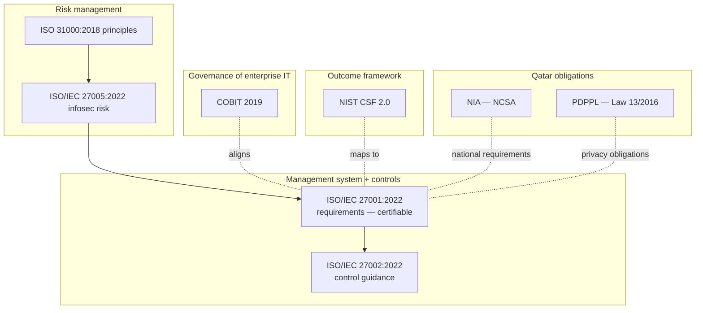
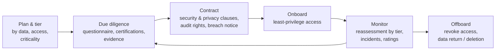
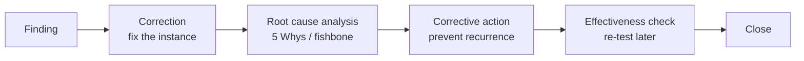

import useBaseUrl from '@docusaurus/useBaseUrl';

# Module 6 — Cybersecurity Governance, Risk & Compliance

:::info[Module status: Draft]
Standards are **summarised**, never reproduced — buy official copies from ISO, ISACA or your national body. Qatar regulatory content is educational and is **not legal advice**; confirm current requirements with the National Cyber Security Agency (NCSA) and legal counsel. Last reviewed 2026-11-07.
:::

## 1. Mandatory, contractual, or good practice?

The first GRC skill is classifying a requirement correctly — it decides who can accept non-compliance.

| Source | Nature | Example | Who can accept a gap? |
|---|---|---|---|
| **Law / regulation** | Mandatory within its scope | Qatar PDPPL (Law No. 13 of 2016) | Nobody internally — only remediation or a regulator-recognised exemption |
| **National mandated standard** | Mandatory for in-scope entities | Qatar NIA for government and specified critical-sector organisations | The regulator, through its defined process |
| **Contract** | Mandatory by agreement | Client requires ISO/IEC 27001 certification | Contract parties |
| **Certifiable standard** | Mandatory **only if** you seek certification | ISO/IEC 27001 clauses 4–10 | Certification body decides conformity |
| **Guidance / framework** | Recommended | ISO/IEC 27002, NIST CSF 2.0, ISO 31000, COBIT | Management, through risk acceptance |

## 2. Framework landscape

## 3. ISO/IEC 27001:2022 and 27002:2022

**ISO/IEC 27001:2022** specifies requirements for an **information security management system (ISMS)**. Clauses 4–10 are mandatory for certification:

| Clause | Theme | Key outputs |
|---|---|---|
| 4 | Context | Internal/external issues, interested parties, **ISMS scope** |
| 5 | Leadership | Policy, roles, top-management commitment |
| 6 | Planning | **Risk assessment and treatment**, **SoA**, objectives, planning of changes |
| 7 | Support | Resources, competence, awareness, communication, documented information |
| 8 | Operation | Run risk assessments and the treatment plan |
| 9 | Performance evaluation | Monitoring and measurement, **internal audit**, **management review** |
| 10 | Improvement | **Nonconformity and corrective action**, continual improvement |

- **Annex A** lists **93 controls** in four themes: Organizational (37), People (8), Physical (14), Technological (34).
- **Amendment 1:2024** added climate-change considerations to clauses 4.1 and 4.2.
- **ISO/IEC 27002:2022** gives implementation guidance for each Annex A control, plus attributes (control type, security properties, cybersecurity concepts, operational capabilities, security domains) useful for filtering and mapping.

Hands-on: [LAB-007 — build an ISO 27001 risk register](../labs/lab-007-iso27001-risk-register.mdx).

## 4. Statement of Applicability (SoA)

The SoA (clause 6.1.3 d) lists **every Annex A control** and states: whether it is included, **why** (inclusion or exclusion), and whether it is implemented. It is the bridge between the **risk register** and the **controls**.

Common audit findings:

- Exclusions justified with *"not applicable"* only — the justification must explain why.
- Controls marked *implemented* with no evidence reference.
- SoA not updated after the risk register changed.

  <a className="button button--secondary" href={useBaseUrl('/templates/soa-template.csv')} download="soa-template.csv">Download SoA template (CSV, simulated rows)</a>

## 5. NIST Cybersecurity Framework 2.0

Published by NIST on **26 February 2024**. Version 2.0 added the **Govern** function and broadened scope to all organisations, not only critical infrastructure.

| Function | ID | Purpose |
|---|---|---|
| **Govern** | GV | Strategy, expectations, policy, roles, oversight, **supply chain risk** |
| Identify | ID | Assets, risks, improvement |
| Protect | PR | Identity and access (PR.AA), awareness, data security, platform security, resilience |
| Detect | DE | Continuous monitoring, adverse event analysis |
| Respond | RS | Incident management, analysis, communication, mitigation |
| Recover | RC | Recovery plan execution and communication |

CSF 2.0 is an **outcome** framework — it says *what* to achieve. Use **Organizational Profiles** (current vs target) and **Tiers** (Partial → Adaptive) to express maturity and priorities, and the NIST **Informative References** to map outcomes to ISO/IEC 27001 controls.

## 6. ISO 31000 and COBIT 2019 — where they fit

- **ISO 31000:2018** — generic risk management **principles, framework and process**. Not certifiable. Gives the vocabulary (risk owner, risk appetite, treatment) used by ISO/IEC 27005 and most enterprise risk functions.
- **COBIT 2019** — framework for **governance and management of enterprise information and technology**. Covered in [Module 7](./it-governance.md).

## 7. Qatar — National Information Assurance (NIA)

- Qatar's **National Information Assurance** framework is managed by the **National Cyber Security Agency (NCSA)**. Earlier versions were developed under the Ministry of Transport and Communications' cybersecurity sector (the NIA Policy version 3 announcement in October 2019 included a National Information Assurance Standard, a Cloud Security Standard and an Industrial Control Systems Security Standard).
- NIA **certification** sits within NCSA's National Information Security Compliance Framework and requires a formal audit by an authorised independent evaluator. Cloud providers publicly report certification against **NIA v2.1** for specified data classifications.
- The NIA is built around **information asset classification**; controls scale with classification level.
- NCSA describes the NIA Standard as setting **mandatory requirements for government entities and organisations operating in key sectors**.

**Practical approach for an ISO 27001 organisation in Qatar:** treat NIA requirements as an additional **requirement source** in clause 4.2, map them to your Annex A controls, record NIA-specific controls in the SoA, and prepare evidence to the NIA audit criteria. Always work from the **current official NIA documents from NCSA** — versions and requirements change.

## 8. Qatar — Personal Data Privacy Protection Law (PDPPL)

- **Law No. 13 of 2016** on the protection of personal data privacy.
- **Regulator:** a dedicated data-privacy office within the **NCSA** (referred to as the National Data Privacy Office and, in recent NCSA communications, the Personal Data Privacy Protection Department). It implements the law, issues guidelines and handles complaints.
- **Regulatory guidelines** (first issued November 2020) set out practical expectations, including:
  - breach notification to the regulator and affected individuals — commentary on the guidelines cites **72 hours**;
  - **data privacy impact assessments** before new or high-risk processing;
  - regulator authorisation for processing **personal data of a special nature** (e.g. health, religion, children, criminal records);
  - processor due diligence and contracts, records of processing, privacy notices, privacy by design and default.
- Enforcement is active: NCSA's privacy office issued published decisions against an ICT provider (December 2024), an e-commerce company (March 2025) and a contracting company (April 2025), citing processing without consent, inadequate safeguards and weak processor oversight.

## 9. GDPR fundamentals (for comparison)

| Topic | GDPR (EU) 2016/679 | Practical note for Qatar organisations |
|---|---|---|
| Applies to | Processing in the EU, or offering goods/services to / monitoring people in the EU | Qatar firms serving EU customers may be in scope |
| Principles | Lawfulness, fairness, transparency; purpose limitation; minimisation; accuracy; storage limitation; integrity & confidentiality; accountability | Similar principles underpin PDPPL |
| Breach notification | To supervisory authority within 72 hours where feasible | Align one incident process to both regimes |
| DPIA | Required for likely high-risk processing | Also expected under PDPPL guidelines |

## 10. Third-party risk management (TPRM)

- **Tier first.** A supplier hosting customer personal data deserves deep assessment; a stationery supplier does not.
- **Certificates are not assurance by themselves** — check the **scope** of an ISO/IEC 27001 certificate or SOC 2 report covers the service you buy.
- ISO/IEC 27001 Annex A **5.19–5.23** cover supplier relationships and cloud services; NIST CSF 2.0 **GV.SC** covers cybersecurity supply-chain risk management.

## 11. Security policy management

A workable policy hierarchy: **Policy** (management intent, short, approved by top management) → **Standards** (mandatory specifics) → **Procedures** (how) → **Guidelines** (recommended). Every document needs an **owner**, **approval**, **version**, **review date** and **communication evidence**.

## 12. Control assessments, internal audit and corrective action

**Control assessment** tests **design** (would the control work if operated?) and **operating effectiveness** (did it work throughout the period?). Sample sizes and periods must be stated.

**Internal audit (clause 9.2)** — planned programme, auditor objectivity (you cannot audit your own work), defined criteria and scope, results reported to management.

**Nonconformity and corrective action (clause 10.2):**

**Correction ≠ corrective action.** Disabling three late leaver accounts is a correction; automating the HR leaver feed is the corrective action.

  <a className="button button--secondary" href={useBaseUrl('/templates/capa-register-template.csv')} download="capa-register-template.csv">Download corrective action (CAPA) register template (CSV)</a>

## 13. Decision exercise

<DecisionScenario
  title="Certificate on file"
  scenario="Procurement wants to onboard a cloud payroll provider next week. The vendor sent an ISO/IEC 27001 certificate and says no further assessment is needed. The service will process all staff salaries and national ID numbers."
  choices={[
    {
      text: 'Accept the certificate and onboard — ISO 27001 proves the vendor is secure.',
      rating: 'risky',
      feedback: 'A certificate says an ISMS conforms for a defined scope. It does not prove the payroll service you are buying is in scope or that controls meet your needs.',
    },
    {
      text: 'Check the certificate scope and validity, request the SoA, complete a high-tier questionnaire, confirm data location and breach-notification terms, and run a DPIA under PDPPL before go-live.',
      rating: 'best',
      feedback: 'Proportionate to a critical supplier processing sensitive personal data, and aligned to PDPPL guideline expectations.',
    },
    {
      text: 'Onboard now and assess within 90 days.',
      rating: 'acceptable',
      feedback: 'Only with a documented, time-bound risk acceptance by the accountable executive and interim contractual protections — and never if PDPPL requires steps before processing starts.',
    },
  ]}
/>

## 14. Knowledge check

<KnowledgeCheck
  questions={[
    {
      q: 'Which NIST CSF 2.0 function was added in version 2.0?',
      options: ['Identify', 'Govern', 'Recover', 'Detect'],
      answer: 1,
      explanation: 'CSF 2.0 (February 2024) added Govern, covering strategy, policy, roles, oversight and supply-chain risk.',
    },
    {
      q: 'An organisation excludes Annex A control 7.4 in its SoA with the justification "N/A". What is the problem?',
      options: [
        'Nothing — N/A is sufficient',
        'Exclusions need a reasoned justification linked to scope and risk',
        '7.4 can never be excluded',
        'The SoA should not list excluded controls',
      ],
      answer: 1,
      explanation: 'Clause 6.1.3 d requires justification for exclusions. "N/A" explains nothing and is a common audit finding.',
    },
    {
      q: 'Which is a CORRECTIVE ACTION rather than a correction?',
      options: [
        'Disabling the three leaver accounts found by the auditor',
        'Automating the HR-to-identity leaver feed with daily reconciliation',
        'Apologising to the auditor',
        'Closing the finding',
      ],
      answer: 1,
      explanation: 'A correction fixes the instance; a corrective action removes the root cause to prevent recurrence.',
    },
    {
      q: 'Who regulates Qatar’s PDPPL?',
      options: ['Qatar Central Bank', 'A data-privacy office within the National Cyber Security Agency (NCSA)', 'ISO', 'The EU'],
      answer: 1,
      explanation: 'Privacy regulation under Law No. 13 of 2016 is carried out by NCSA’s data-privacy office, which issues guidelines, handles complaints and has issued enforcement decisions.',
    },
  ]}
/>

## References

- ISO — [ISO/IEC 27001:2022](https://www.iso.org/standard/27001) · [ISO/IEC 27002:2022](https://www.iso.org/standard/75652.html) · [ISO 31000:2018](https://www.iso.org/standard/65694.html)
- NIST — [Cybersecurity Framework 2.0](https://www.nist.gov/cyberframework) (26 February 2024)
- Qatar National Cyber Security Agency (NCSA) — obtain the current NIA and PDPPL documents from NCSA's official website
- MOTC — [Version 3 of the National Information Assurance Policy announced](https://www.mot.gov.qa/en/news/motc-announces-version-3-national-information-assurance-policy-0) (31 October 2019)
- Google Cloud — [Qatar NIA compliance](https://cloud.google.com/security/compliance/nia) (example of NIA v2.1 certification scope)
- The Peninsula — [NCSA confirms Milaha's NIA compliance](https://s.thepeninsula.qa/article/28/01/2026/qatar-bolsters-cybersecurity-as-ncsa-confirms-milahas-compliance-for-nia) (28 January 2026)
- The Peninsula — [NCSA highlights role of the privacy department](https://www.thepeninsulaqatar.com/article/10/06/2026/ncsa-highlights-key-role-of-pdppd-in-safeguarding-privacy-rights) (10 June 2026)
- Baker McKenzie — [Qatar data protection enforcement update](https://connectontech.bakermckenzie.com/data-protection-enforcement-update-qatar/)
- Clyde & Co — [Regulatory guidelines on the Qatar Personal Data Protection Law](https://www.clydeco.com/en/insights/2021/03/new-regulatory-guidelines-on-the-qatar-persona-1) (March 2021)
- EUR-Lex — [Regulation (EU) 2016/679 (GDPR)](https://eur-lex.europa.eu/eli/reg/2016/679/oj)
