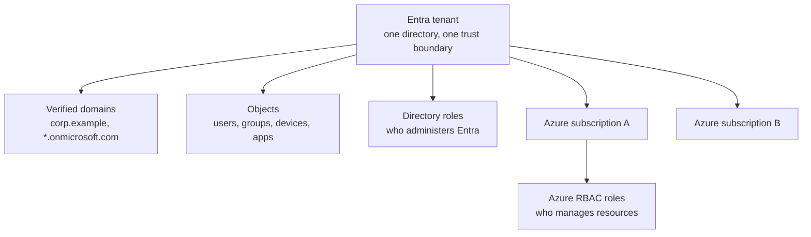
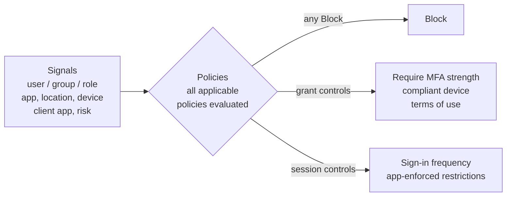
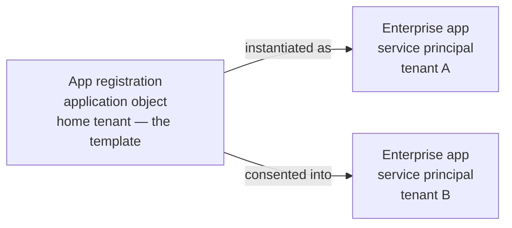

# Module 2 — Microsoft Entra ID

:::info[Module status: Draft]
Checked against Microsoft Learn on 2026-11-07. Microsoft renames menus frequently — if a path differs in your tenant, search the admin center for the feature name.
:::

## 1. Licensing at a glance

Know this table before designing anything — many audit findings are really licensing gaps.

| Capability | Free | P1 | P2 | ID Governance |
|---|---|---|---|---|
| Users, groups, SSO, security defaults | ✓ | ✓ | ✓ | add-on |
| Administrative units (create / members) | ✓ | ✓ | ✓ | |
| AU-scoped role assignment (per admin) | | ✓ | ✓ | |
| Custom directory roles, dynamic groups | | ✓ | ✓ | |
| **Conditional Access** | | ✓ | ✓ | |
| **ID Protection** risk policies | | | ✓ | |
| **Privileged Identity Management** | | | ✓ | ✓ |
| Access reviews (core) / entitlement management (core) | | | ✓ | ✓ |
| Lifecycle workflows, ML-assisted reviews | | | | ✓ |

Microsoft states that no new identity governance features will be added to the P2 SKU — new IGA capabilities land in **Microsoft Entra ID Governance**.

## 2. Tenant architecture



**Two separate role systems** — confusing them is a classic finding:

| | Microsoft Entra roles | Azure RBAC roles |
|---|---|---|
| Controls | The directory: users, groups, apps, policies | Azure resources: VMs, storage, key vaults |
| Example | Global Administrator, Helpdesk Administrator | Owner, Contributor, Reader |
| Scope | Tenant, administrative unit, or single app | Management group, subscription, resource group, resource |

## 3. Users and groups

- **Member** vs **guest** users (B2B collaboration). Guests deserve their own Conditional Access and access-review policies.
- **Security groups** grant access; **Microsoft 365 groups** add mailbox, Teams and SharePoint.
- **Assigned** vs **dynamic** membership (dynamic needs P1). Dynamic rules depend on clean HR attributes — garbage in, access out.
- **Role-assignable groups** can hold directory roles; only Privileged Role Administrators (or higher) can change their membership.

## 4. Roles and scopes

Apply least privilege on three axes: **role**, **scope**, **time**.

- Use the most specific built-in role (Helpdesk Administrator, not User Administrator, for password resets).
- Narrow scope with **administrative units** — see [LAB-003](../labs/lab-003-entra-rbac.mdx).
- Narrow time with **PIM** — see Module 4.
- Microsoft's guidance: fewer than **five** Global Administrators, and fewer than **ten** privileged role assignments.

## 5. Conditional Access (P1)

Conditional Access is Entra's **policy engine**: it evaluates signals after first-factor authentication and decides what the session requires.



Key rules: **every applicable policy must be satisfied**, and **Block wins**. Always test in **report-only** mode and with the **What If** tool. LAB-002 builds a policy set and deliberately creates a conflict.

## 6. MFA and authentication methods

- Configure methods in **Entra ID → Authentication methods → Policies**.
- Require **authentication strengths** in Conditional Access: *Multifactor authentication*, *Passwordless MFA*, or *Phishing-resistant MFA*.
- **2026 changes:** Microsoft announced passkeys as the default authentication experience from **1 September 2026**, and retirement of Microsoft's native SMS/voice delivery on **1 February 2027**. Plan migrations away from SMS now.
- Hands-on: [LAB-001](../labs/lab-001-entra-mfa.mdx).

## 7. Microsoft Entra ID Protection (P2)

| Signal | Applies to | Example detections |
|---|---|---|
| **Sign-in risk** | A single sign-in | Anonymous IP address, unfamiliar sign-in properties |
| **User risk** | The identity overall | Leaked credentials, accumulated risky sign-ins |

Risk levels feed **risk-based Conditional Access** — e.g., require a password change when user risk is high. Without P2, reports are limited and risk policies are unavailable.

## 8. Privileged Identity Management (P2 / ID Governance)

Users are **eligible** for a role and **activate** it when needed, for a limited time, with MFA, justification and optional approval. Covered in Module 4.

## 9. Access reviews and entitlement management

- **Access reviews** — periodic recertification of group members, app assignments, guest access and role assignments.
- **Entitlement management** — **access packages** bundle groups, apps and sites with request, approval and **expiry** policies, including incompatible-package SoD checks.

Both are covered in Module 3.

## 10. App registrations vs enterprise applications



| | App registration | Enterprise application |
|---|---|---|
| Object | Application object | Service principal |
| Exists in | The app's home tenant | Every tenant that uses the app |
| You configure | Redirect URIs, credentials, API permissions exposed/requested | User assignment, SSO, Conditional Access, consent granted |

**Security review points:** applications with **application permissions** (app-only) to high-impact Graph scopes, client secrets that don't expire or have no owner, and user consent settings that allow users to grant risky permissions.

## 11. Microsoft Graph PowerShell

The supported module for scripting Entra ID. The older MSOnline and AzureAD PowerShell modules are deprecated — migrate scripts to Microsoft Graph PowerShell.

```powershell
# Install for the current user
Install-Module Microsoft.Graph -Scope CurrentUser

# Connect with the least-privileged scopes the task needs
Connect-MgGraph -Scopes "User.Read.All","Directory.Read.All"

# Read-only examples
Get-MgUser -Top 5 -Property DisplayName,UserPrincipalName,AccountEnabled |
  Select-Object DisplayName, UserPrincipalName, AccountEnabled

Get-MgDirectoryRole | Select-Object DisplayName, Id   # roles with at least one member

Disconnect-MgGraph
```

**Governance tip:** grant scripts the **narrowest Graph scopes** and prefer **managed identities** or certificate credentials over client secrets for automation.

## 12. Hybrid identity fundamentals

| Component / option | Purpose | Note |
|---|---|---|
| **Entra Connect Sync** | Synchronises AD DS objects to Entra ID from an on-premises server | Treat the sync server as a **Tier 0 / control-plane** asset |
| **Entra Cloud Sync** | Lightweight agent-based sync managed from the cloud | Check feature parity for your scenario |
| **Password hash synchronisation (PHS)** | Cloud authentication using a hash of the AD password hash | Enables leaked-credential detection; resilient if on-premises is down |
| **Pass-through authentication (PTA)** | Validates passwords against on-premises AD via agents | Depends on on-premises availability |
| **Federation (e.g. AD FS)** | On-premises IdP authenticates users | Most complex; a high-value attack target |

## 13. Decision exercise

<DecisionScenario
  title="Replacing security defaults"
  scenario="A 400-user organisation with Entra ID P1 still uses security defaults. The CISO asks you to move to Conditional Access this week with minimum risk."
  choices={[
    {
      text: 'Disable security defaults now, then design Conditional Access policies over the next few days.',
      rating: 'risky',
      feedback: 'The tenant would have no MFA enforcement during the design period. Prepare and test policies first.',
    },
    {
      text: 'Create break-glass accounts, build the policies in report-only, validate with What If and sign-in logs, then disable security defaults and switch policies On in the same change window.',
      rating: 'best',
      feedback: 'Protection is never removed, exclusions are in place before enforcement, and impact is evidenced before go-live.',
    },
    {
      text: 'Enable Microsoft-managed Conditional Access policies and leave it there.',
      rating: 'acceptable',
      feedback: 'A sensible baseline immediately after disabling security defaults, but it does not replace a designed policy set with your own exclusions and personas.',
    },
  ]}
/>

## 14. Knowledge check

<KnowledgeCheck
  questions={[
    {
      q: 'An engineer has the Owner role on an Azure subscription. Can they reset Entra ID users’ passwords by virtue of that role?',
      options: ['Yes — Owner is the highest role', 'No — Azure RBAC and Entra roles are separate systems', 'Only for guest users', 'Only with PIM'],
      answer: 1,
      explanation: 'Azure RBAC roles govern Azure resources. Directory operations such as password resets need Entra roles.',
    },
    {
      q: 'Which object is created in YOUR tenant when users consent to a third-party SaaS app?',
      options: ['An app registration', 'A service principal (enterprise application)', 'A guest user', 'An administrative unit'],
      answer: 1,
      explanation: 'The app registration lives in the vendor’s home tenant; your tenant gets a service principal representing it.',
    },
    {
      q: 'Two Conditional Access policies apply: one requires MFA, one blocks access. What happens?',
      options: ['MFA is required, then access granted', 'Access is blocked', 'The newest policy wins', 'The user chooses'],
      answer: 1,
      explanation: 'All applicable policies are enforced and Block takes precedence over grant controls.',
    },
    {
      q: 'Which licence is required for user-risk and sign-in-risk policies?',
      options: ['Free', 'P1', 'P2', 'Office 365 E1'],
      answer: 2,
      explanation: 'Microsoft Learn lists risk policies (including Microsoft-managed remediation policies) as P2 capabilities.',
    },
  ]}
/>

## References

- Microsoft Learn — [Microsoft Entra licensing](https://learn.microsoft.com/entra/fundamentals/licensing)
- Microsoft Learn — [Microsoft Entra ID Governance licensing fundamentals](https://learn.microsoft.com/entra/id-governance/licensing-fundamentals) (last updated 2026-10-16)
- Microsoft Learn — [What is Microsoft Entra ID Protection?](https://learn.microsoft.com/entra/id-protection/overview-identity-protection)
- Microsoft Learn — [Best practices for Microsoft Entra roles](https://learn.microsoft.com/entra/identity/role-based-access-control/best-practices)
- Microsoft Learn — [Use the What If tool for Conditional Access](https://learn.microsoft.com/entra/identity/conditional-access/what-if-tool)
- Microsoft Learn — [Application and service principal objects](https://learn.microsoft.com/entra/identity-platform/app-objects-and-service-principals)
- Microsoft Learn — [Microsoft Graph PowerShell overview](https://learn.microsoft.com/powershell/microsoftgraph/overview)
- Microsoft Learn — [Hybrid identity: choose the right authentication method](https://learn.microsoft.com/entra/identity/hybrid/connect/choose-ad-authn)
