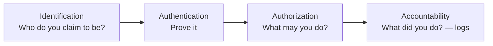
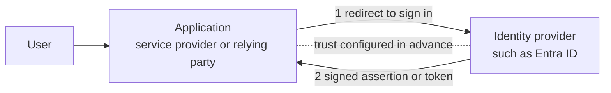
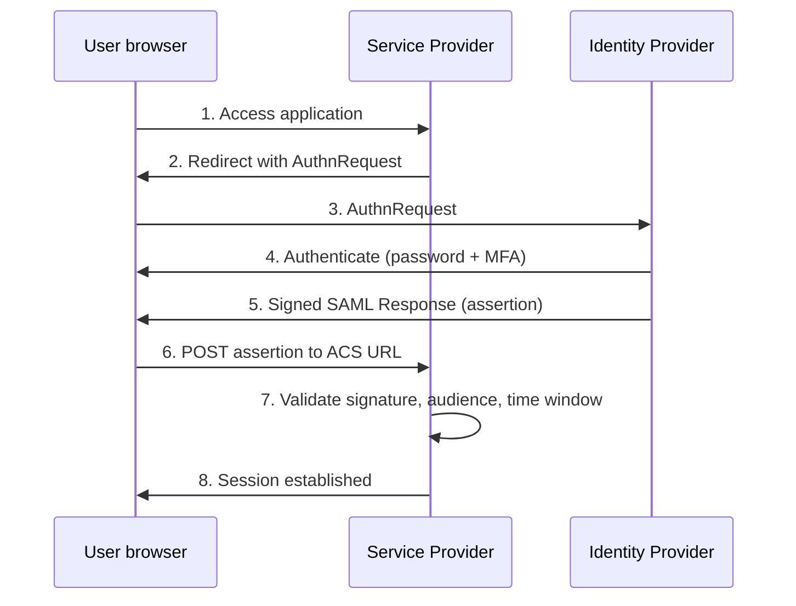
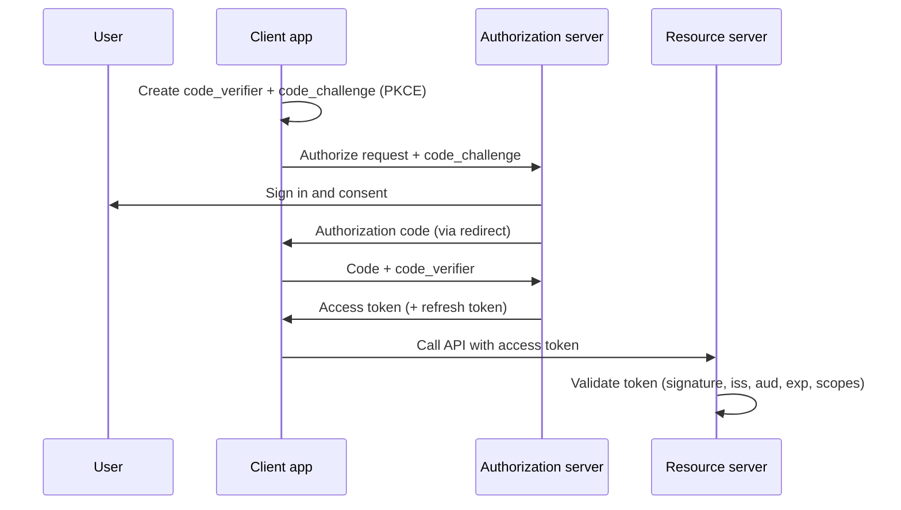

# Module 1 — IAM Fundamentals

:::info[Module status: Draft]
Written and checked against the primary sources listed at the end. Last reviewed 2026-11-07.
:::

Identity and access management answers one question repeatedly, at scale: **should this subject be allowed to do this action on this resource, right now?** Everything in this module — factors, protocols, models — is a mechanism for answering that question reliably and proving afterwards how it was answered.

## 1. Identity vs account

| Term | Meaning | Example |
|---|---|---|
| **Identity** | The real-world entity — a person, workload or device — and its attributes | *Mariam, Finance Analyst, Doha office* |
| **Account** | A record in one system that represents the identity and holds credentials and entitlements | `mariam@corp.example` in Entra ID; `MARIAMF` in the ERP |
| **Entitlement** | A specific permission held by an account | *Approve purchase orders* |

One identity usually has **many accounts**. Identity governance (Module 3) exists largely to correlate those accounts back to one accountable person — an account that cannot be correlated is an **orphaned account**.

## 2. Identification, authentication, authorization, accountability

A useful audit habit: for any access control, ask which of the four steps it implements and where its **evidence** is. MFA strengthens *authentication*; RBAC implements *authorization*; sign-in and audit logs provide *accountability*.

## 3. Authentication factors and MFA

| Factor category | Something you… | Examples |
|---|---|---|
| Knowledge | know | Password, PIN |
| Possession | have | Security key, phone with authenticator app, smart card |
| Inherence | are | Fingerprint, face (usually unlocks a possession factor) |

**MFA** requires factors from **two or more different categories**. A password plus a security question is still single-factor — both are knowledge.

### Phishing resistance

Not all MFA is equal. An attacker-in-the-middle proxy can relay a password and a one-time code, or trick a user into approving a push notification. **Phishing-resistant** authenticators — FIDO2/WebAuthn passkeys and certificate-based authentication — cryptographically bind the sign-in to the legitimate site's origin, so a look-alike domain receives nothing reusable.

NIST released the final **SP 800-63-4** *Digital Identity Guidelines* in **July 2025**, in four volumes: 63-4 (overview and risk management), 63A-4 (identity proofing), 63B-4 (authentication) and 63C-4 (federation). Revision 4 integrates **syncable authenticators such as synced passkeys** into the guidance. Use 63B-4 when you need authoritative definitions of authenticator assurance levels (AAL1–AAL3).

:::tip[GRC view]
When an auditor asks *"Is MFA enforced?"*, the stronger answer names the **method strength** and the **scope**: *"Phishing-resistant MFA for all privileged roles; MFA strength for all other users; break-glass accounts excluded and monitored."* That is exactly what LAB-001 and LAB-002 build.
:::

## 4. Authorization models

| Model | Decision based on | Strengths | Weaknesses | Typical use |
|---|---|---|---|---|
| **RBAC** — role-based | Roles assigned to the subject | Simple to review and certify | *Role explosion* when every exception becomes a role | Enterprise apps, Entra directory roles |
| **ABAC** — attribute-based | Attributes of subject, resource, action and environment | Fine-grained, context-aware | Harder to review: "who has access?" needs evaluation | Data classification, Azure ABAC conditions |
| **PBAC** — policy-based | Centrally managed policies evaluated by a policy engine (often combining roles and attributes) | Consistent across apps; policy as code | Requires mature policy management | API gateways, Zero Trust policy engines |

NIST SP 800-162 is the reference guide to ABAC. In practice most organisations run **RBAC for coarse access** and add **attribute or context conditions** for sensitive actions — Conditional Access (Module 2) is a policy engine that does precisely this at sign-in.

## 5. Least privilege and separation of duties

- **Least privilege** — grant the minimum permissions, at the narrowest scope, for the shortest time needed. All three dimensions matter; LAB-003 narrows *scope*, Module 4 narrows *time*.
- **Need to know** — least privilege applied to information.
- **Separation of duties (SoD)** — no single person can complete a sensitive process end-to-end (for example, create a vendor *and* release its payment). Module 3 has an interactive SoD checker.

## 6. Single sign-on and federation

- **SSO** — authenticate once, access many applications without re-entering credentials.
- **Federation** — SSO **across trust boundaries**: an application (relying party / service provider) trusts an **identity provider (IdP)** in another domain to authenticate users, based on a pre-established trust (metadata, certificates).

## 7. SAML 2.0

An OASIS standard (2005) that exchanges **XML assertions** between an IdP and a service provider (SP). Still dominant for enterprise SaaS SSO.

**Security checks the SP must perform:** signature validation with the IdP's certificate, `Audience` restriction, `NotBefore`/`NotOnOrAfter` window, `InResponseTo` matching the request, and replay protection.

## 8. OAuth 2.0 — delegated authorization

OAuth 2.0 (RFC 6749) lets a **client application** obtain an **access token** to call an API **on a user's behalf** without receiving the user's password. It is an **authorization** framework — it does not, by itself, tell the client who the user is.

| Role | Meaning |
|---|---|
| Resource owner | The user who owns the data |
| Client | The application requesting access |
| Authorization server | Issues tokens (e.g. Entra ID) |
| Resource server | The API that accepts tokens |

**Current best practice — RFC 9700, *Best Current Practice for OAuth 2.0 Security* (BCP 240, January 2025):**

- Use the **authorization code** grant with **PKCE** (RFC 7636).
- Do **not** use the **implicit** grant or the **resource owner password credentials** grant.
- Restrict token privileges to the minimum (scopes, audience) and use **exact redirect URI matching**.

## 9. OpenID Connect — authentication on top of OAuth

**OpenID Connect (OIDC) Core 1.0** adds an identity layer to OAuth 2.0. The client receives an **ID token** — a JWT that states *who authenticated, when, and for which client*.

| Token | Audience | Purpose |
|---|---|---|
| **ID token** (OIDC) | The client app | Proves user authentication to the client |
| **Access token** (OAuth) | The API | Authorises calls to the API |
| **Refresh token** | Authorization server | Obtains new access tokens without re-prompting |

A common vulnerability is an API accepting an **ID token** as if it were an access token, or a client accepting tokens issued for **another audience**.

## 10. JWT fundamentals

A **JSON Web Token** (RFC 7519) in its common signed form has three base64url parts: `header.payload.signature`. **Signed is not encrypted** — anyone holding the token can read its claims. Try it with this fabricated token:

<JwtDecoder />

**Validation rules for an API:** verify the signature with the issuer's published key; reject `alg: none`; check `iss`, `aud`, `exp`, `nbf`; then authorise using `roles` or `scp` claims. Never put secrets or sensitive personal data in claims.

## 11. Identity lifecycle

Identities move through **Joiner → Mover → Leaver**. Each transition must change access: provision on join, adjust (and *remove* old access) on move, revoke promptly on leave. The mover stage causes the most **privilege creep**. Module 3 covers lifecycle governance in depth; LAB-004 simulates it.

## 12. Knowledge check

<KnowledgeCheck
  questions={[
    {
      q: 'A user signs in with a password and answers a security question. Is this MFA?',
      options: ['Yes — two steps were completed', 'No — both are knowledge factors', 'Yes, if the security question is long', 'Only if logged'],
      answer: 1,
      explanation: 'MFA requires factors from different categories. Password and security question are both "something you know".',
    },
    {
      q: 'Which OAuth 2.0 grant does RFC 9700 recommend for applications acting on behalf of a user?',
      options: ['Implicit grant', 'Resource owner password credentials', 'Authorization code with PKCE', 'Client credentials'],
      answer: 2,
      explanation: 'RFC 9700 (January 2025) recommends authorization code with PKCE and says the implicit and password grants should not be used.',
    },
    {
      q: 'An API receives a token and decodes it successfully. What must it do before trusting the roles claim?',
      options: [
        'Nothing — decoding proves authenticity',
        'Verify the signature and validate iss, aud, exp and nbf',
        'Check the token is longer than 500 characters',
        'Ask the user to confirm',
      ],
      answer: 1,
      explanation: 'Anyone can decode a JWT. Trust comes only from signature verification plus issuer, audience and time-window validation.',
    },
    {
      q: 'Which protocol is primarily an AUTHENTICATION protocol?',
      options: ['OAuth 2.0', 'OpenID Connect', 'SCIM', 'RBAC'],
      answer: 1,
      explanation: 'OIDC adds authentication (the ID token) on top of OAuth 2.0, which is an authorization framework.',
    },
    {
      q: 'Why is a security key (FIDO2) phishing-resistant while an SMS code is not?',
      options: [
        'Security keys are more expensive',
        'The key cryptographically binds the response to the legitimate site origin',
        'SMS codes are shorter',
        'Security keys never expire',
      ],
      answer: 1,
      explanation: 'FIDO2/WebAuthn signs a challenge bound to the origin; a look-alike phishing domain cannot obtain a response usable on the real site. An SMS code can simply be relayed.',
    },
  ]}
/>

## References

- NIST — [SP 800-63-4 Digital Identity Guidelines](https://pages.nist.gov/800-63-4) (final, July 2025)
- NIST — [SP 800-162 Guide to Attribute Based Access Control](https://csrc.nist.gov/pubs/sp/800/162/upd2/final)
- IETF — [RFC 6749 The OAuth 2.0 Authorization Framework](https://www.rfc-editor.org/rfc/rfc6749)
- IETF — [RFC 7636 Proof Key for Code Exchange (PKCE)](https://www.rfc-editor.org/rfc/rfc7636)
- IETF — [RFC 9700 Best Current Practice for OAuth 2.0 Security](https://www.rfc-editor.org/info/rfc9700) (January 2025)
- IETF — [RFC 7519 JSON Web Token](https://www.rfc-editor.org/rfc/rfc7519)
- OpenID Foundation — [OpenID Connect Core 1.0](https://openid.net/specs/openid-connect-core-1_0.html)
- OASIS — [SAML 2.0 Core specification](https://docs.oasis-open.org/security/saml/v2.0/saml-core-2.0-os.pdf) (March 2005)
