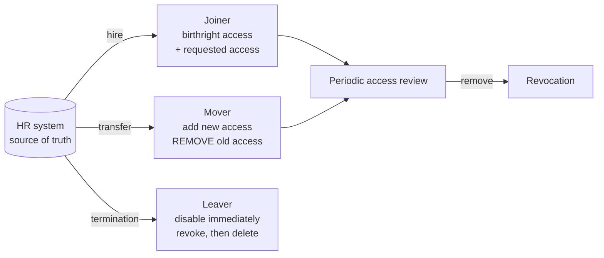

import useBaseUrl from '@docusaurus/useBaseUrl';

# Module 3 — Identity Governance & Administration

:::info[Module status: Draft]
Examples use a fictional organisation. Last reviewed 2026-11-07.
:::

Access management decides **at sign-in time**. Identity governance answers the auditor's questions **over time**: *Who has access to what? Should they? Who approved it? Was it removed when they left?*

## 1. The Joiner-Mover-Leaver lifecycle



| Stage | Control objective | Typical failure | Evidence |
|---|---|---|---|
| **Joiner** | Access granted only on approved request; birthright access defined by role | Copy-paste "same access as Ahmed" | Approved request, provisioning log |
| **Mover** | Old access removed when duties change | **Privilege creep** — access accumulates over years | Transfer ticket, revocation log |
| **Leaver** | Access disabled by the last working day | Accounts active weeks after departure | HR termination date vs disable timestamp |

:::tip[Audit test]
Take the HR leavers list for a quarter and compare each **termination date** with the **account disable date** across Entra ID *and* each in-scope application. Any account still enabled after the agreed SLA is an exception. This single test finds more issues than most policy reviews.
:::

## 2. Provisioning

- **Authoritative source:** HR drives identity creation and attribute changes; IT should not be creating employees by hand.
- **SCIM 2.0** (RFC 7643 schema, RFC 7644 protocol) is the standard for provisioning users and groups into SaaS apps. Entra ID provisions to SCIM-enabled apps from **Enterprise applications → Provisioning**.
- **Deprovisioning is the control that matters most.** Confirm that disabling a user in the source actually disables or removes the downstream account — test it, don't assume it.

## 3. Role engineering

| Approach | How | Risk |
|---|---|---|
| **Top-down** | Derive roles from job functions and processes with business owners | Slow; may not match reality |
| **Bottom-up (role mining)** | Cluster existing entitlements to find common patterns | Can institutionalise existing excess access |
| **Hybrid** | Mine, then validate with business owners | Recommended |

Watch for **role explosion** (a role per exception) and define **birthright** access (granted automatically on joining) separately from **requestable** access.

## 4. Access certification

Periodic reviews where an accountable person confirms each access is still needed.

| Design choice | Recommendation |
|---|---|
| Reviewer | Manager for job access; **resource owner** for sensitive systems; never self-review |
| Frequency | Risk-based — quarterly for privileged and financial access, annually for low-risk |
| Non-response | Define the default (e.g. **remove** on non-response for high-risk access) |
| Decision helpers | Show last sign-in, justification, peer comparison |
| Closure | Revocations completed and **verified**, not just decided |

**Rubber-stamping** — approving everything without review — is the most common failure. Look for reviewers who approve hundreds of items in seconds and zero revocations campaign after campaign.

<div className="margin-bottom--md">
  <a className="button button--secondary" href={useBaseUrl('/templates/access-review-template.csv')} download="access-review-template.csv">Download access review template (CSV)</a>
</div>

## 5. Segregation of duties

Some combinations of access are **toxic** together even if each is legitimate alone. Try different combinations for this fictional finance analyst:

<SodChecker />

- **Preventive SoD** blocks the conflicting assignment at request time (e.g. incompatible access packages in Entra entitlement management).
- **Detective SoD** reports conflicts after the fact for review.
- When a conflict must be accepted (small teams), document an **approved exception** with a **mitigating control**, an owner and an expiry date.

<div className="margin-bottom--md">
  <a className="button button--secondary" href={useBaseUrl('/templates/sod-matrix-template.csv')} download="sod-matrix-template.csv">Download SoD matrix template (CSV)</a>
</div>

## 6. Orphaned and dormant accounts

| Term | Definition | Detection |
|---|---|---|
| **Orphaned** | Account with no valid, active owner identity (owner left, or never correlated) | Correlate application accounts to HR records; list unmatched |
| **Dormant** | Active account not used for a defined period (e.g. 90 days) | Last sign-in data |
| **Shared / generic** | Account used by several people | Naming patterns, no owner attribute |

In Entra ID, the `signInActivity` property on users gives last sign-in information (it requires Entra ID P1 or P2):

```powershell
Connect-MgGraph -Scopes "User.Read.All","AuditLog.Read.All"

$cutoff = (Get-Date).AddDays(-90)
Get-MgUser -All -Property DisplayName,UserPrincipalName,AccountEnabled,SignInActivity |
  Where-Object { $_.AccountEnabled -and (
      -not $_.SignInActivity.LastSignInDateTime -or
      $_.SignInActivity.LastSignInDateTime -lt $cutoff ) } |
  Select-Object DisplayName, UserPrincipalName,
                @{n='LastSignIn'; e={$_.SignInActivity.LastSignInDateTime}}
```

Treat the output as **candidates**: confirm with owners before disabling, and exclude break-glass and service accounts that are governed separately.

## 7. Policy violations and governance workflows

Common IGA policies and what happens on violation:

| Policy | Violation example | Workflow |
|---|---|---|
| Every account has an owner | Orphaned account found | Owner assignment within 5 days, else disable |
| No SoD conflicts without exception | User holds SOD-02 pair | Remove one entitlement or raise time-bound exception |
| Privileged access is time-bound | Permanent Global Administrator (not break-glass) | Convert to PIM-eligible |
| Guests are reviewed quarterly | Guest not reviewed in 2 cycles | Disable guest |

## 8. Concepts across platforms

IGA concepts are vendor-neutral; product terminology differs. A rough mapping:

| Concept | SailPoint (Identity Security Cloud / IdentityIQ) | Microsoft Entra ID Governance |
|---|---|---|
| Authoritative source | Source (HR connector) | HR inbound provisioning |
| Bundle of entitlements | Access profile / role | Access package |
| Request & approval | Access request | Entitlement management request policy |
| Recertification | Certification campaign | Access review |
| SoD rule | SoD policy | Incompatible access packages / groups |
| Lifecycle automation | Lifecycle states, workflows | Lifecycle workflows |

Check each vendor's current documentation before relying on a specific feature — product capabilities change frequently.

## 9. Identity governance metrics

| Metric | Type | Why it matters |
|---|---|---|
| % of leavers disabled within SLA | KPI | Direct measure of leaver control effectiveness |
| Orphaned accounts (count, trend) | KRI | Accounts nobody is accountable for |
| Dormant privileged accounts | KRI | High-value targets that nobody notices |
| Access review completion rate | KPI | Reviews not completed are not a control |
| Revocation rate per campaign | KPI (sanity) | ~0% over several campaigns suggests rubber-stamping |
| Open SoD conflicts without exception | KRI | Unmitigated fraud risk |
| Mean time to provision | KPI | Business friction — drives workarounds if too slow |

## 10. Knowledge check

<KnowledgeCheck
  questions={[
    {
      q: 'Which lifecycle stage is most associated with privilege creep?',
      options: ['Joiner', 'Mover', 'Leaver', 'Rehire'],
      answer: 1,
      explanation: 'Movers gain new access but old access is often not removed, so entitlements accumulate.',
    },
    {
      q: 'A manager approved 100% of 400 access items in 3 minutes, with no revocations in four campaigns. What does this indicate?',
      options: ['Excellent access hygiene', 'Possible rubber-stamping — the control may not be operating', 'Reviews are too frequent', 'Nothing'],
      answer: 1,
      explanation: 'Speed and a zero-revocation pattern are classic indicators that reviews are not genuinely performed.',
    },
    {
      q: 'Which standard is used to provision users and groups into SaaS applications?',
      options: ['SAML 2.0', 'SCIM 2.0', 'OIDC', 'LDAP'],
      answer: 1,
      explanation: 'SCIM (RFC 7643/7644) defines a schema and REST protocol for cross-domain provisioning.',
    },
    {
      q: 'A small company cannot avoid one user holding both "post invoices" and "release payments". What is the GRC-appropriate response?',
      options: [
        'Ignore it — the company is small',
        'Document a time-bound exception with a mitigating control such as dual control on payment runs',
        'Give the user Global Administrator',
        'Delete the ERP',
      ],
      answer: 1,
      explanation: 'Accepted SoD conflicts need a documented, approved, time-bound exception plus a compensating control.',
    },
  ]}
/>

## References

- IETF — [RFC 7643 SCIM Core Schema](https://www.rfc-editor.org/rfc/rfc7643) and [RFC 7644 SCIM Protocol](https://www.rfc-editor.org/rfc/rfc7644)
- Microsoft Learn — [Microsoft Entra ID Governance licensing fundamentals](https://learn.microsoft.com/entra/id-governance/licensing-fundamentals)
- Microsoft Learn — [What are access reviews?](https://learn.microsoft.com/entra/id-governance/access-reviews-overview)
- Microsoft Learn — [What is entitlement management?](https://learn.microsoft.com/entra/id-governance/entitlement-management-overview)
- Microsoft Learn — [What are lifecycle workflows?](https://learn.microsoft.com/entra/id-governance/what-are-lifecycle-workflows)
- ISO — [ISO/IEC 27002:2022](https://www.iso.org/standard/75652.html) controls 5.15–5.18 (access control, identity management, authentication information, access rights) and 5.3 (segregation of duties)
