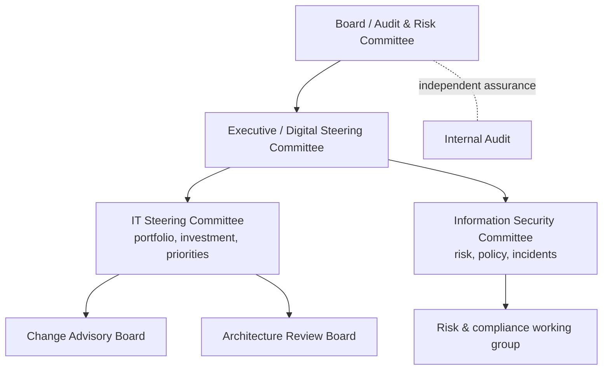

# Module 7 — IT Governance

:::info[Module status: Draft]
COBIT content is summarised from ISACA's public descriptions; obtain the COBIT 2019 publications from ISACA for full detail. Last reviewed 2026-11-07.
:::

## 1. Governance vs management

| | Governance | Management |
|---|---|---|
| Question | *Are we doing the right things?* | *Are we doing things right?* |
| Who | Board, executive committees | CIO, CISO, IT managers |
| Activities | **Evaluate, Direct, Monitor** | **Plan, Build, Run, Monitor** |
| Outputs | Direction, priorities, risk appetite, approvals | Plans, projects, services, controls |

ISO/IEC 38500 (current edition 2024) expresses the same idea: the governing body **evaluates**, **directs** and **monitors** the use of IT, while management plans and operates it.

## 2. IT governance operating model



### Committee charter essentials

| Element | Example — Information Security Committee |
|---|---|
| Purpose | Oversee information security risk within approved appetite |
| Chair / members | COO (chair), CISO (secretary), CIO, Legal, HR, Risk, business heads |
| Quorum | Chair + 50% of members |
| Frequency | Quarterly, plus ad hoc for major incidents |
| Decision rights | Approve security policies; accept risks up to *High*; escalate *Critical* to Executive Committee |
| Inputs | Risk register, KRI dashboard, audit findings, incident summary |
| Outputs | Minutes, decisions log, action tracker |

## 3. Strategy alignment

Link every significant IT initiative to an enterprise goal and a measurable benefit. COBIT's **goals cascade** traces stakeholder drivers → **enterprise goals** → **alignment goals** → governance and management objectives. A simple test for any project: *which enterprise goal does this serve, and which metric will prove it?*

## 4. COBIT 2019 essentials

COBIT 2019 contains **40 governance and management objectives** in five domains:

| Domain | Type | Count | Examples |
|---|---|---|---|
| **EDM** — Evaluate, Direct and Monitor | Governance | 5 | EDM03 Ensured risk optimisation |
| **APO** — Align, Plan and Organise | Management | 14 | APO12 Managed risk · APO13 Managed security |
| **BAI** — Build, Acquire and Implement | Management | 11 | BAI06 Managed IT changes |
| **DSS** — Deliver, Service and Support | Management | 6 | DSS05 Managed security services |
| **MEA** — Monitor, Evaluate and Assess | Management | 4 | MEA03 Managed compliance with external requirements |

- **Components** (formerly enablers) make each objective work: processes, organisational structures, principles and policies, information, culture and behaviour, people and skills, services and infrastructure.
- **Design factors** (enterprise strategy, risk profile, threat landscape, compliance requirements, sourcing model and others) tailor which objectives matter most.
- **Capability levels** (0–5, CMMI-based) rate processes; **maturity** applies to focus areas.

## 5. Policies and standards

Governance **directs** through policy. A minimum IT policy set: information security, acceptable use, access control, change management, backup and recovery, IT asset management, third-party/cloud, data classification and handling, and AI use (Module 8). Each needs an owner, approver, review cycle and exceptions process.

## 6. IT risk management

IT risk sits inside enterprise risk management, not beside it. Use the **same risk scale and appetite** as the enterprise (the [LAB-007](../labs/lab-007-iso27001-risk-register.mdx) criteria approach), and report IT risks in business language: *"Payment processing could be unavailable for more than 24 hours"*, not *"backup server is end-of-life"*.

## 7. Service and change governance

- **Service governance** — service catalogue, SLAs with business owners, capacity and availability reviews, supplier performance.
- **Change governance** — classify changes (standard / normal / emergency); require risk assessment, testing evidence, approval, and a rollback plan; review **failed and emergency changes** monthly. Security configuration (e.g. Conditional Access in [LAB-002](../labs/lab-002-conditional-access.mdx)) is a change like any other.

## 8. IT project oversight

Stage gates with explicit criteria: business case → design (including security and privacy by design) → build/test → go-live readiness → benefits review. Escalate when cost, time or scope tolerances are exceeded; track **benefits realised**, not just delivery.

## 9. KPIs vs KRIs

| | KPI — Key Performance Indicator | KRI — Key Risk Indicator |
|---|---|---|
| Looks | Backward: did we perform? | Forward: is risk rising? |
| Example | % of changes implemented without incident | # of critical vulnerabilities > 30 days old |
| Trigger | Target missed | **Threshold** crossed → escalation |

### Example governance indicator set

| Indicator | Type | Target / threshold (example) |
|---|---|---|
| Critical patches applied within 14 days | KPI | ≥ 95% |
| Critical vulnerabilities open > 30 days | KRI | Amber > 5 · Red > 10 |
| Successful backup restore tests (quarter) | KPI | 100% of critical systems |
| Privileged accounts without MFA | KRI | Red if > 0 |
| Leavers disabled within 1 working day | KPI | ≥ 98% |
| Failed changes (month) | KPI | < 5% |
| Overdue audit actions | KRI | Amber > 3 · Red > 0 high-rated |
| Critical suppliers without current assessment | KRI | Red if > 0 |

## 10. Executive reporting template

Boards read the first page only. Structure it accordingly:

```text
IT & SECURITY GOVERNANCE REPORT — Q4 2026 (simulated example)

1. Overall status:  AMBER  (was GREEN)
   Why: two KRIs breached thresholds; no major incidents.

2. Decisions requested
   a) Approve QAR 450k to replace end-of-life backup platform (risk R-002).
   b) Accept residual risk R-005 (website) — Low, owner: Marketing Director.

3. Top risks (vs appetite)
   R-002 Ransomware on finance share   High → Medium after funding   Owner: CFO
   R-003 Payroll supplier breach       High (treatment due Mar 2027)   Owner: HR Director

4. Key indicators                      Target   Actual  Trend
   Critical patches ≤14 days            95%      91%     ↓  AMBER
   Privileged accounts without MFA      0        0       →  GREEN
   Overdue high-rated audit actions     0        2       ↑  RED

5. Compliance
   ISO/IEC 27001 surveillance audit: 0 major, 2 minor findings (CAPA-001, CAPA-003).
   PDPPL: DPIA completed for HR assistant pilot (AI-001).

6. Next quarter priorities (max 3)
```

## 11. Knowledge check

<KnowledgeCheck
  questions={[
    {
      q: 'Which COBIT 2019 domain contains the GOVERNANCE objectives?',
      options: ['APO', 'EDM', 'DSS', 'MEA'],
      answer: 1,
      explanation: 'EDM (Evaluate, Direct and Monitor) holds the five governance objectives; the other four domains are management.',
    },
    {
      q: '"Number of critical vulnerabilities open for more than 30 days" is best described as a…',
      options: ['KPI', 'KRI', 'SLA', 'OKR'],
      answer: 1,
      explanation: 'It signals rising exposure and should have an escalation threshold — a key risk indicator.',
    },
    {
      q: 'What should the first section of a board IT report contain?',
      options: [
        'A full list of all tickets',
        'Overall status and the decisions the board is asked to take',
        'Technical architecture diagrams',
        'Vendor marketing',
      ],
      answer: 1,
      explanation: 'Executives need status, decisions requested, and top risks against appetite — detail belongs in appendices.',
    },
    {
      q: 'Who should approve the information security policy?',
      options: ['Any IT administrator', 'Top management', 'The external auditor', 'The software vendor'],
      answer: 1,
      explanation: 'ISO/IEC 27001 clause 5.2 makes top management responsible for establishing the information security policy.',
    },
  ]}
/>

## References

- ISACA — [COBIT 2019 framework](https://www.isaca.org/resources/cobit)
- ISO — [ISO/IEC 38500:2024 Governance of IT for the organization](https://www.iso.org/standard/81684.html)
- ISO — [ISO/IEC 27001:2022](https://www.iso.org/standard/27001) clause 5 (Leadership) and 9.3 (Management review)
- NIST — [Cybersecurity Framework 2.0](https://www.nist.gov/cyberframework) — Govern (GV) function
