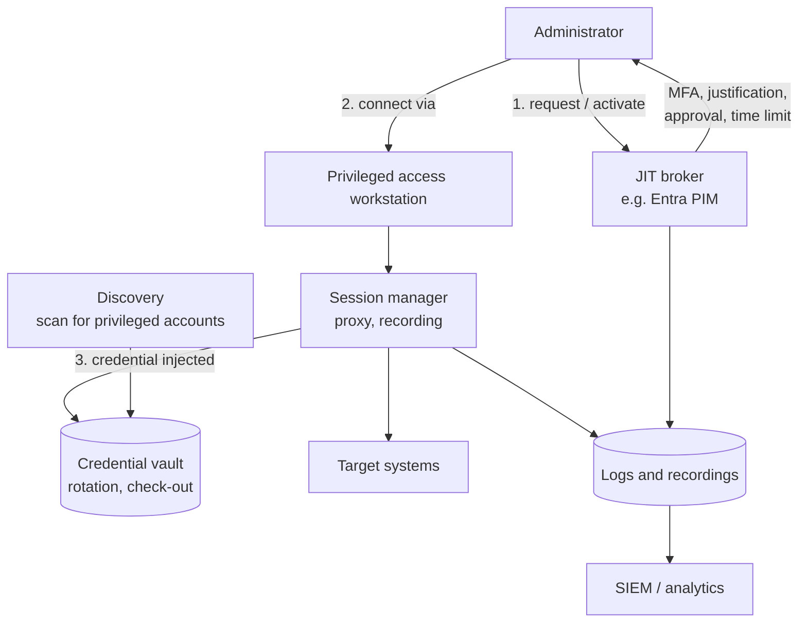
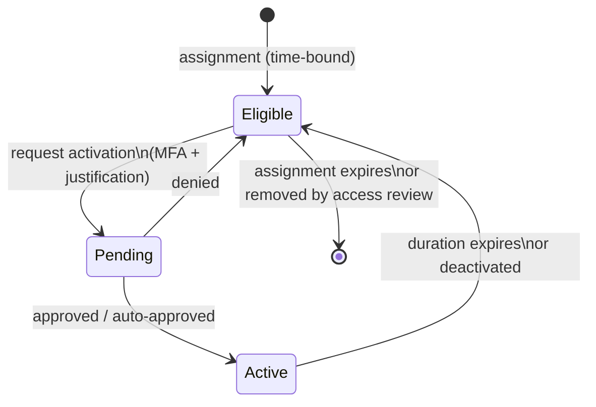

# Module 4 — Privileged Access Management

:::info[Module status: Draft]
Conceptual and vendor-neutral, with Microsoft Entra PIM as the worked example. All scenarios are simulated. Last reviewed 2026-11-07.
:::

Privileged accounts are the shortest path from a single compromised credential to a full breach. PAM reduces **how many** privileged accounts exist, **how long** privilege is held, and **how well** its use is observed.

## 1. What counts as privileged?

- **Directory and identity administrators** — Global Administrator, Privileged Role Administrator, domain admins.
- **Infrastructure administrators** — hypervisor, cloud subscription Owner, firewall and backup admins.
- **Application super-users** — ERP `SAP_ALL`-style roles, database `sysadmin`/`DBA`.
- **Non-human identities** — service accounts, app registrations with high-impact permissions, CI/CD pipeline credentials, API keys.
- **Business-privileged users** — staff who can release payments or change bank details. Not technically "admins", but high impact.

## 2. PAM reference architecture

## 3. Discovery

You cannot govern what you have not found. Discovery sources:

- Directory role and group memberships (Entra roles, AD privileged groups).
- Local administrator groups on servers and endpoints.
- Cloud role assignments (Azure Owner/Contributor, AWS/GCP equivalents).
- Application databases for super-user roles.
- Secrets in code repositories, scripts and pipelines.

Output: a **privileged account inventory** with owner, purpose, type (human / service / break-glass), authentication method and review date.

## 4. Just-in-time (JIT) and just-enough administration (JEA)

| | Meaning | Example |
|---|---|---|
| **Standing privilege** | Role assigned permanently | Permanent Global Administrator |
| **Just-in-time** | Role held only while needed, then expires automatically | PIM activation for 2 hours |
| **Just-enough** | Only the specific permissions the task needs | Windows PowerShell JEA endpoint exposing only `Restart-Service` for named services |

### Microsoft Entra PIM model (P2 / ID Governance)

Typical PIM role settings to define per role: maximum activation duration, MFA / authentication context on activation, justification required, ticket number required, approval required (and approvers), notifications, and **expiry of eligible assignments** so eligibility itself is re-justified.

:::warning
Emergency access accounts are the exception: Microsoft recommends assigning them Global Administrator as **permanent active**, not eligible, so they work when PIM or MFA services are unavailable. See [LAB-001](../labs/lab-001-entra-mfa.mdx).
:::

## 5. Privileged session monitoring

- Route sessions through a proxy or bastion so administrators never see target credentials.
- Record sessions for high-risk systems; index commands and keystrokes where lawful.
- Alert on high-risk commands (disabling logging, creating accounts, exporting data).
- **Privacy and legal:** session recording captures personal data — define purpose, retention and access in policy, and inform administrators.

## 6. Credential vaulting concepts

| Concept | Purpose |
|---|---|
| **Check-out / check-in** | Exclusive, logged use of a shared credential |
| **Automatic rotation** | Password changed after each use or on schedule — a stolen copy expires |
| **Credential injection** | The session manager logs in for the user; the password is never displayed |
| **Dual control** | Two people required to retrieve the most sensitive credentials |

## 7. Break-glass accounts

Recap of the controls from LAB-001: at least two, cloud-only, phishing-resistant method that differs from normal admins, excluded from blocking Conditional Access policies, **alert on every sign-in**, test at least every 90 days, credentials stored securely in separate locations.

## 8. Service account governance

| Risk | Control |
|---|---|
| Password never changes | Prefer **managed identities** (no credential to steal) or certificate credentials with rotation |
| No owner | Mandatory owner and business purpose in the inventory |
| Interactive sign-in possible | Deny interactive logon; use Conditional Access for workload identities where licensed |
| Over-permissioned | Least-privilege API permissions; review application permissions in Entra |
| Secret in source code | Secret scanning in repositories; store in a vault (e.g. Azure Key Vault) |

## 9. Privileged access reviews

- Review **eligible and active** privileged assignments at least **quarterly**.
- Reviewer should be the **role owner** or security, not the privileged user's peer.
- Remove eligibility that has not been activated in the review period — unused privilege is pure risk.
- Entra access reviews can target **Entra roles** and **PIM for Groups** memberships (licensing in Module 2).

## 10. Privileged access risk assessment

A simple, transparent scoring approach for each privileged account (developed further in LAB-006):

| Factor | 1 (lower risk) | 3 | 5 (higher risk) |
|---|---|---|---|
| **Scope of privilege** | Single app | Department systems | Tenant / domain-wide |
| **Standing vs JIT** | JIT with approval | JIT self-activated | Permanent |
| **Authentication** | Phishing-resistant | MFA (push/OTP) | Password only |
| **Monitoring** | Session recorded + alerts | Logs only | No logging |
| **Human vs non-human** | Human, named | Service account with owner | Shared or ownerless |

Score = sum (5–25). Prioritise the highest scores for remediation. Document the method so results are repeatable — the same principle as ISO 27001 risk criteria in [LAB-007](../labs/lab-007-iso27001-risk-register.mdx).

## 11. Decision exercise

<DecisionScenario
  title="The 2 a.m. production outage"
  scenario="A database administrator needs Owner on a production subscription at 2 a.m. to fix an outage. The approver for that PIM role is asleep."
  choices={[
    {
      text: 'Give the DBA a permanent Owner assignment so this never happens again.',
      rating: 'risky',
      feedback: 'Converts an operational problem into permanent standing privilege — the opposite of PAM.',
    },
    {
      text: 'Use a pre-defined emergency procedure: a second on-call approver group for the role, short activation, ticket number required, and post-incident review of the session logs.',
      rating: 'best',
      feedback: 'Keeps JIT and approval, removes the single point of failure, and creates evidence for review.',
    },
    {
      text: 'Have the DBA use a break-glass account.',
      rating: 'acceptable',
      feedback: 'Only if the documented break-glass criteria are met (e.g. identity services unavailable). Break-glass is for identity emergencies, not routine operational access — overuse erodes its control value.',
    },
  ]}
/>

## 12. Knowledge check

<KnowledgeCheck
  questions={[
    {
      q: 'What is the main risk reduced by just-in-time privileged access?',
      options: ['Licence cost', 'The window in which a compromised account holds privilege', 'Password complexity', 'Network latency'],
      answer: 1,
      explanation: 'With JIT, privilege exists only during activation; a stolen credential is far less useful the rest of the time.',
    },
    {
      q: 'Which non-human identity option avoids storing any credential that can be stolen?',
      options: ['Client secret', 'Shared service account password', 'Managed identity', 'API key in a config file'],
      answer: 2,
      explanation: 'Managed identities obtain tokens from the platform; there is no secret for the workload or an attacker to exfiltrate.',
    },
    {
      q: 'An eligible PIM assignment has not been activated for 12 months. What should the access review decide?',
      options: ['Keep — eligibility costs nothing', 'Remove — unused privilege is unnecessary risk', 'Convert to permanent', 'Duplicate it'],
      answer: 1,
      explanation: 'Unused eligibility still expands the attack surface (an attacker with the account can activate it). Remove and re-request if needed.',
    },
    {
      q: 'Why is session recording a governance as well as a technical decision?',
      options: [
        'It is free',
        'It processes personal data, so purpose, retention and access must be defined and communicated',
        'It replaces MFA',
        'It removes the need for logs',
      ],
      answer: 1,
      explanation: 'Recordings contain personal data; privacy law (e.g. Qatar PDPPL, GDPR) and policy must govern their use.',
    },
  ]}
/>

## References

- Microsoft Learn — [What is Microsoft Entra Privileged Identity Management?](https://learn.microsoft.com/entra/id-governance/privileged-identity-management/pim-configure)
- Microsoft Learn — [Manage emergency access accounts](https://learn.microsoft.com/entra/identity/role-based-access-control/security-emergency-access)
- Microsoft Learn — [Privileged access (Zero Trust)](https://learn.microsoft.com/security/zero-trust/security-concept-privileged-access) and [privileged access devices](https://learn.microsoft.com/security/privileged-access-workstations/privileged-access-devices)
- Microsoft Learn — [Just Enough Administration (PowerShell)](https://learn.microsoft.com/powershell/scripting/security/remoting/jea/overview)
- Microsoft Learn — [Managed identities for Azure resources](https://learn.microsoft.com/entra/identity/managed-identities-azure-resources/overview)
- ISO — [ISO/IEC 27002:2022](https://www.iso.org/standard/75652.html) control 8.2 Privileged access rights
- NIST — [Cybersecurity Framework 2.0](https://www.nist.gov/cyberframework) PR.AA
